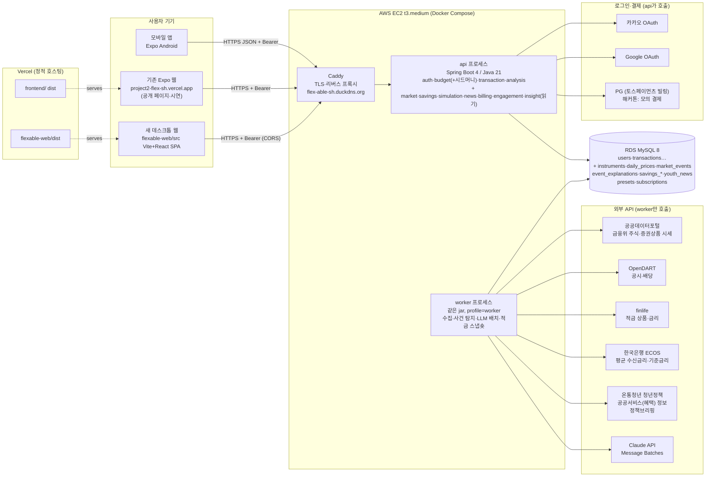

> 2026-10-20: 웹 제품 문서의 정본을 flexable-web으로 이전했다. 서버·계정·DB 경계는 [앱·웹 서비스 경계](04-service-boundaries.md)(2026-10-20 분리 결정)가 우선한다. 구현 현황은 [저장소 README](../../README.md), 아래 기획·회의 기록은 완료 보고가 아니다.

> 2026-10-20 데이터 후속 합의: 적금·시세·종목 뉴스·AI 해석의 저장·갱신은 [웹 데이터 저장·자동 갱신 계획](05-data-refresh.md)을 따른다. 웹 DB 구성과 자동 갱신의 해커톤 포함 여부는 미정이다. 기존 MySQL·RDS·VM 내 DB 표기와 작업 시각은 이전 가정이다.

# 03. 데스크톱 웹사이트 아키텍처·데이터·인프라 계획 (개발 리드, 3라운드 반영본 v2)

작성: 개발(아키텍트) 에이전트 · 기준일 2026-10-17 · 대상: 텅장관리(Flex-able) 새 데스크톱 웹(React + Spring)
읽는 사람: 팀장, 기획(01-product.md), 디자인(02-design.md), 사람 개발자(프론트·백엔드·데이터)

> 표기 규칙
> - **[확인]** 웹 검색·공식 페이지로 확인한 사실(출처 URL 첨부). **[2차]** 블로그·서드파티 자료로만 확인. **[미확인]** 확인 못 함 — 첫 주에 직접 호출·문의로 확인할 것.
> - 저장소는 읽기만 했다. 코드 경로는 저장소 기준 상대 경로.
> - 금액은 기존 원칙대로 **원 단위 정수(long), 금액 계산은 내림**, 서버가 최종값을 계산한다(`BudgetCalculator`와 같은 원칙). 수량(소수점 주식 수)·비율은 정수가 아니다(6장).
>
> **v2 변경(3라운드):** 팀장 확정 12개(`decisions.md`), 기획·디자인 교차 리뷰의 03 항목(교차 리뷰 기록, 저장소에 없음), 내 리뷰 메모(E2)를 반영했다. 바뀐 곳: 시드머니 `current`·`todaySaved`·직접 수정(3-4), 계산 정의 12개 확정본(6장), 소수점 매수, 사건 상세를 기획 템플릿 필드로(5-5·8장), 핀 툴팁 필드, 원금·비교선 시계열, 목표·공유·이벤트 로깅·온보딩 플래그·잠금 메타데이터 API, 무료/유료 표(10장), 해커톤 범위 축소 WBS(12장), 폐쇄망 시연 대본(13장), 남은 이견(14장), 대표 질문 7개(15장). 로그인 문구·콜백 만료 문구는 소셜 로그인 PR #59 기준.

## 목차
0. 한 장 요약 (먼저 읽기)
1. 결정 요약 (ADR 8개)
2. 전체 아키텍처
3. 앱↔웹 연동 (계정·OAuth·시드머니·CORS·토큰 저장)
4. 외부 데이터 소스 조사 결과
5. 데이터 파이프라인 (시세·사건 탐지·사건 설명·적금·청년 소식)
6. 계산 정의 확정본 12개 (시뮬레이션·적금·시드머니)
7. DB 스키마 초안 (Flyway V6~)
8. API 계약 초안
9. 배포·인프라 (AWS·Vercel·도메인·CI·모니터링·폐쇄망 VM)
10. 결제와 무료/유료 경계
11. 보안·비용·리스크
12. 작업 분담(WBS)과 일정 — 해커톤 범위
13. 시연 대본 (인터넷 / 폐쇄망)
14. 남은 이견
15. 대표에게 물어볼 질문 (7개, 우선순위 순)
부록 A. 출처 목록

---

## 0. 한 장 요약

**구조:** 새 웹은 별도 저장소 [`shinds-team7/flexable-web`](https://github.com/shinds-team7/flexable-web)(Vite + React + TypeScript, Vercel)로 만들고, 서버는 **기존 Spring 백엔드에 패키지를 추가하는 모듈러 모놀리스**로 간다. 같은 jar를 `api` 프로세스와 `worker`(수집·사건 탐지·LLM 사전 생성) 프로세스 두 개로 띄운다. DB는 지금 RDS MySQL. 계정·JWT·소셜 로그인(PR #59)은 앱과 **완전히 같은 것**을 쓰고, 웹 주소만 redirectUri·CORS 허용 목록에 추가한다.

**확정 반영 핵심(팀장 확정 12개 → 개발 설계):**
| 확정 | 설계 |
|---|---|
| 1 시드머니 | `GET /me/seed-money` = 끝난 주기 합계(`total`) + `current`(이번 주기, 거래 입력 즉시 바뀜) + `todaySaved`(오늘 아낀 돈, 누적 안 함) + 직접 수정(`PUT /me/seed-money/manual`, 수정값 우선) |
| 2 기본값 | `funding.mode=PACE`(지금 저축 속도로) + 시작 **3년 전**. 기간 칩·날짜 지정 모두 무료 |
| 3 소수점 매수 | 수량은 소수 8자리, 금액만 원 단위 내림. 결과 아래 고정 가정 문장 |
| 4 범위 | 국내 주식 + 국내 상장 지수 ETF만 저장·노출. 해외 탭·버튼 없음 |
| 5 사건 설명 무료 | `GET /market/events/{id}`를 기획 템플릿(무슨 일 / 시장 반응 / 왜 / 그 뒤에는 / 근거 / 고지) 필드 그대로. 잠금 없음 |
| 6 적금 | 정렬만(기본금리·최고금리·기간), 순위 필드 없음, 정책 적금 계산기 추가. 2026-10-20 팀 회의: 과거 시점 비교 삭제, 정책 적금은 [지금 가입하면]의 금융권 선택지 |
| 7 무료/유료 | 한도는 서버 설정값 1곳(`GET /billing/plans`의 `limits`·`features`), 잠금 응답에 `feature` 키 |
| 8 범위 축소 | 우대조건 반영·계정 합치기·이메일 발송·서버 개인화 고도화·실시간 AI·앱 홈 목표 표시는 해커톤 제외 |
| 9 추가 | 목표(웹), 공유 페이지, 모의 결제 결과, 온보딩 '봤음', 자체 지표 이벤트 로깅 |
| 10 로그인 | "카카오 로그인" / "Google 계정으로 로그인" / "이메일로 로그인"(PR #59) |
| 11 페르소나 | 시연 계정 '지수': 끝난 주기 6개, 시드머니 470,000원, 저축 속도 월 78,000원 |
| 12 오프라인 | 시연 데이터 스냅숏 + 사전 생성 설명이 기본 경로, 폐쇄망이면 시연 계정(이메일) |

**가장 큰 리스크는 기술이 아니라 데이터 라이선스와 규제다.**
- 무료 국내 시세(공공데이터포털 금융위 주식·증권상품 시세)는 **공공누리 제4유형(출처표시·상업적 이용금지·변경금지)**, 상업 이용은 "KRX Data Marketplace 유료 구매" 안내 [확인]. KRX Open API는 사용하지 않으며, KIS는 핀테크 제휴 불가 [확인]. → 해커톤은 비상업 시연, **990원 결제를 실제로 받기 전에 상업 라이선스 확보**(대표 결정).
- 네이버 검색 API는 2026-09-07 특약으로 저장·캐싱·AI 입력이 금지됐다[2차]. → 사건 근거는 DART 공시·시장 데이터·사람이 쓴 사건 카드, 기사는 사람이 넣은 제목·언론사·링크만.
- 2024-08-14 시행 개정으로 양방향 유료 회원제 투자 조언은 투자자문업(등록) [확인]. → 종목 판단·AI 종목 상담은 유료·무료 모두 없음, 사건 설명 전부 무료.

**인프라:** t3.micro·6.7GB는 부족 → **t3.medium(4GB) + EBS gp3 30GB + 탄력적 IP**(EC2 쪽 월 약 $45, RDS·Vercel Pro 포함 약 $85~110 추정). Vercel Hobby는 비상업 전용 → 실결제 시작 전 Pro($20/월) 또는 정적 호스팅 이전.

**LLM:** 사건 설명·소식 요약은 Message Batches로 **미리 만들어 DB에 저장**, 사람 검수 후 승인분만 노출. 실시간 생성 0건. 해커톤 시연 종목 15~20개 기준 생성 비용은 몇 달러 수준(11-3).

**첫 주에 반드시 할 일:** ① finlife 적금 스냅숏 수집 시작(과거 금리는 나중에 못 구함) ② 금융위 시세 API의 가장 오래된 기준일 확인(3년 기본값이 되는지) ③ 시연 계정 '지수' 시드 데이터·시연 종목·사건 30건 목록을 기획과 고정 ④ 대표 질문 7개(15장) 답 받기.

---

## 1. 결정 요약 (ADR)

형식: 맥락 → 결정 → 버린 대안 → 결과(감수할 것). ADR-2·4·6·8은 2라운드 교차 리뷰와 팀장 확정(`decisions.md`)으로 **합의됨**, ADR-1은 2026-10-20 [서버 분리 결정](04-service-boundaries.md)으로 바뀌었다. 나머지 미합의 항목은 팀장 확인 대기.

### ADR-1. 서버: 기존 Spring 백엔드에 모듈 추가(모듈러 모놀리스) + 프로세스 2개

> **2026-10-20 변경: 분리로 바뀜. [04-service-boundaries.md](04-service-boundaries.md)가 우선한다.** 웹은 flexable-web `backend/`의 별도 서버·DB·계정을 쓰고, 앱 정보는 [앱 연동하기]로만 받는다. 아래는 당시 결정 기록이다. 패키지 구성과 api·worker 프로필 분리는 웹 백엔드에서 그대로 쓴다. 이 문서 다른 곳의 공유 서버·`/api/v1/web` 경로 설명도 04를 따른다.
- **맥락:** 웹은 앱과 같은 사용자·JWT·DB를 써야 한다. 팀은 작고, 운영 중인 서버는 1대(Docker Compose + Caddy)다. 새 기능의 대부분은 "매일 한 번 수집·계산해 두고 읽기만 하는" 성격이다.
- **결정:** `project2/backend/`에 패키지를 추가한다: `market`(종목·시세·사건), `insight`(사건 설명·LLM), `savings`(적금 상품·금리), `simulation`(계산 엔진·프리셋), `news`(청년 소식), `billing`(구독·결제·요금제 한도), `engagement`(목표·공유·사용자 설정·지표 이벤트), `ingest`(수집 작업 공통). 시드머니 계산은 기존 `budget` 패키지에 둔다(`BudgetCalculator`의 수입일 계산 재사용). **같은 jar**를 Spring profile로 두 번 띄운다.
  - `api`: 지금과 같은 HTTP 서버. 스케줄러 꺼짐.
  - `worker`: HTTP 포트 없음(`spring.main.web-application-type=none`), 수집·사건 탐지·LLM 배치만. 실행 프로세스를 분리한다. 같은 호스트의 자원 경합은 컨테이너 제한·DB 풀 상한으로 제어한다(04-service-boundaries).
- **버린 대안:** (a) 별도 서비스(시세 서비스 + 인증 공유) — 서비스 간 인증·배포 파이프라인이 두 배가 된다. (b) Python 데이터 파이프라인 — 데이터 담당이 편하지만 언어·배포가 하나 더 늘고 폐쇄망 반입 대상도 늘어난다. 분석 실험(노트북)은 Python으로 해도 되지만 **운영 수집기는 Java로 통일**한다.
- **결과:** 패키지 경계를 지키는 규칙이 필요하다 — `market`/`savings`/`news`는 다른 도메인 패키지를 import하지 않고, `simulation`만 `market`·`savings`를 읽는다(ArchUnit 테스트 1개로 막는다). 나중에 트래픽이 커지면 `worker`부터 별도 서버로 뺀다.

### ADR-2. 프론트: Vite + React + TypeScript SPA, 저장소는 별도 `flexable-web` (2026-10-19 변경)
- **맥락:** 데스크톱 중심, 차트·시뮬레이션 상호작용이 많다. 폐쇄망 VM에서도 정적 파일만으로 띄울 수 있어야 한다. 기존 Expo 웹(`project2/frontend/`)은 모바일 화면이라 재사용하기 어렵다.
- **결정:** 별도 저장소 `flexable-web`에 Vite + React + TS. 라우팅 React Router, 서버 상태 TanStack Query, 작은 클라이언트 상태(시뮬레이션 조합 편집 중인 값) Zustand, 폼 검증 Zod. 디자인 토큰은 `project2/frontend/src/theme/index.ts`의 값을 CSS 변수로 옮겨 같은 색(신한 블루 `#0046FF`·네이비 잉크)을 쓴다. 공유 링크 미리보기(카카오톡 OG 태그)는 공유 주소 `https://<웹>/s/:id`를 Vercel `rewrites`로 API의 `GET /share/{id}/og`(OG 메타 + 화면 이동만 담은 HTML)에 넘기고, 사람은 SPA의 `/p/:id` 화면으로 이동하는 방식으로 해결한다(SPA는 미리보기 봇이 JS를 실행하지 않아 OG를 못 준다). 랜딩 예시 차트는 **웹 빌드에 정적 JSON으로 포함**해 API가 죽어도 뜨게 한다.
- **버린 대안:** Next.js(SSR/ISR로 SEO·OG가 쉽다) — Node 서버가 하나 더 생기고 폐쇄망 반입·운영이 복잡해진다. 청년 소식 페이지 SEO가 BM상 중요해지면 그때 소식 페이지만 사전 렌더링(빌드 시 정적 HTML 생성)을 붙인다.
- **결과:** `project2/docs/API.md`가 앱·웹 공통 계약이다. 웹 저장소는 자체 CI와 `AGENTS.md`를 둔다. 앱 시연도 그 저장소의 `/m`(`mobile-demo/`, Expo 웹)으로 옮겼다.
- **변경(2026-10-19, 팀장 결정):** 처음에는 project2의 `web/`를 계획했으나 웹 UI와 시연을 flexable-web으로 분리했다. 2026-10-20부터 웹 제품 기획 정본도 이 저장소에서 관리한다. 웹 기능의 서버 구현은 공유 API인 project2/backend에서 진행하며, 계약 변경 기능은 두 저장소의 연계 PR로 검증한다. 계약 정본은 `project2/docs/API.md`다.

### ADR-3. 데이터 패칭: 서버 계산 + TanStack Query 캐시, 공개 GET은 HTTP 캐시
- **결정:** 시뮬레이션 결과·적금 이자·세금·사건 전후 내 돈·원금 시계열·비교선은 **모두 서버가 계산**한다(클라이언트 재계산 금지, AGENTS.md 원칙 유지). 웹은 결과를 그리기만 한다. 고지 문장도 서버 상수 한 곳에서 `noticeKey`와 함께 내려 준다(8-3). 무료/유료 한도도 서버 설정값 한 곳(`GET /billing/plans`)에서 내려 준다. 시세·사건·소식 같은 공개 GET은 `Cache-Control: public, max-age=300` + ETag. 시뮬레이션 POST는 입력 해시로 서버 메모리 캐시(Caffeine, 10분).
- **결과:** 슬라이더를 움직일 때마다 서버를 부르므로 웹에서 300ms 디바운스, 서버는 1회 계산 50ms 이내 목표(10년 일봉 × 5종목은 데이터 1.3만 점 정도라 충분).

### ADR-4. 차트: visx(타임머신) + Recharts(단순 차트) — 디자인 문서 추천 반영
- **맥락:** 타임머신 그래프는 10년치 일별 선 위에 사건 핀을 찍고, 마우스오버 툴팁·클릭 상세·**키보드 탐색(←/→ 핀 이동, Enter 상세)** 이 필요하다(02-design.md 1-8·6-5).
- **결정:** 타임머신은 **visx**(저수준 SVG, 스케일을 그대로 써서 사건 핀을 HTML `<button>`으로 차트 위에 정확히 올림). 적금 막대·조합 비중 같은 단순 차트는 **Recharts**. 공통 축·툴팁 컴포넌트를 먼저 만들어 두 라이브러리의 모양을 맞춘다.
- **성능 조건:** SVG 점 수를 줄이기 위해 서버가 3년 초과 기간은 주 단위로 줄여 보내고(6-4), 사건 핀은 원래 날짜를 유지한다. 선 1개 약 2,500점 × 다리 5개 이하에서 문제없을 것으로 본다 — W2에 실측.
- **버린 대안:** TradingView Lightweight Charts(캔버스·금융 시계열 기능은 좋지만 **TradingView 표기·링크 의무**[2차: https://unpkg.com/lightweight-charts@5.0.7/README.md], 캔버스라 핀 접근성을 따로 만들어야 하고 트레이딩 앱 느낌), ECharts(번들 큼), D3 직접 구현(기간 부족).

### ADR-5. 시장 데이터 저장: RDS MySQL 일봉 테이블 + 일 1회 증분 수집
- **결정:** 시세는 **일봉만** 저장한다(분봉·실시간 없음). `daily_prices`의 PK를 `(instrument_id, trade_date)`로 잡아 종목별 기간 조회가 클러스터드 인덱스 범위 스캔이 되게 한다. 수정주가는 원가격과 **누적 수정계수**를 함께 저장하고 조회 시 곱한다. 파티셔닝·별도 시계열 DB는 쓰지 않는다(용량 추정 5장: 최대 약 1.5GB).
- **버린 대안:** 요청 때마다 외부 API 호출(한도·약관·폐쇄망 모두 불리), TimescaleDB·ClickHouse(운영 대상 증가).

### ADR-6. LLM 사용 범위: "사전 생성 + 사람 검수 + 캐시"만, 실시간 호출 기본 0건
- **결정:** 사건 인과 설명과 청년 소식 요약은 `worker`가 **Message Batches API(50% 할인)** 로 미리 만들어 DB에 넣고, 화면은 DB만 읽는다. 생성물에는 `review_status`(DRAFT/APPROVED/REJECTED)를 두고, **화면에는 APPROVED만** 나간다(설명이 없는 사건은 "설명 없는 핀"으로 날짜·등락률만). 모든 설명에 고정 고지(`EVENT_EXPLAIN`)를 붙인다. 기본 모델은 `claude-opus-5-5`(입력 $4 / 출력 $20 per MTok). 해커톤 생성량이 수백 건이라 비용은 몇 달러 수준(11-3). 사용자별 실시간 생성(리포트 AI 요약 등)은 해커톤 제외(팀장 확정 8).
- **이유:** ① 비용 예측 가능 ② 폐쇄망에서도 같은 화면 ③ 투자자문업 리스크(양방향 유료 상담) 회피 ④ 근거 없는 문장 검수 가능.
- **결과:** "AI에게 물어보기" 같은 실시간 대화 기능은 만들지 않는다(필요하면 예적금·생활비·청년정책 범위로 한정하고 별도 검토).

### ADR-7. 인증: 앱과 같은 JWT(Bearer), 웹 1단계는 localStorage, 도메인 구매 후 httpOnly 쿠키
- **결정:** 웹도 `POST /auth/oauth/exchange` → `accessToken`(30일)을 받아 `Authorization: Bearer`로 보낸다. 1단계(해커톤)는 기존 Expo 웹과 같이 localStorage에 저장하고 XSS 완화책(CSP, 서드파티 스크립트 금지)을 둔다. 도메인을 사서 웹·API가 같은 사이트(`www.<도메인>`·`api.<도메인>`)가 되면 2단계로 **짧은 access token(메모리) + httpOnly refresh 쿠키**로 바꾼다. 상세는 3장.

### ADR-8. 외부 데이터 소스: 해커톤은 공공 API, 유료화 전 라이선스 교체
- **결정:** 해커톤까지는 공공데이터포털(금융위 시세)·DART·finlife·ECOS·온통청년·공공서비스(혜택)로 만들고 화면에 출처를 표시한다. **990원 결제를 실제로 받기 전에** 시세 데이터 라이선스(KRX Data Marketplace 유료 또는 신한 계열 제휴)를 확보한다. 해외 주식은 무료 API가 대부분 비상업·비표시 조건이라 빼고, **국내 상장 해외지수 ETF**(미국 S&P500·나스닥100 추종 등)로 대신 보여 준다. 아직 없는 해외 기능은 탭·버튼·"이후" 표시로도 노출하지 않는다(팀장 확정 4). 근거는 4장.

---

## 2. 전체 아키텍처



ASCII 요약(머메이드가 안 보일 때):

```text
[앱]──┐
[Expo 웹]──┼─HTTPS(Bearer)─▶ Caddy ─▶ api(Spring) ─▶ RDS MySQL ◀─ worker(Spring, 같은 jar)
[새 React 웹(Vercel)]─┘                    │                              │
                                           ├─▶ 카카오/Google OAuth          ├─▶ 금융위 시세 · DART · finlife · ECOS
                                           └─▶ PG(토스, 해커톤은 모의)       ├─▶ 온통청년 · 공공서비스(혜택) · 정책브리핑
                                                                            └─▶ Claude API(Batches, 사전 생성)
```

**요청 하나가 지나가는 길(예: 타임머신 실행):**
`flexable-web/src/pages/TimeMachine.tsx(구현 예정)` → `flexable-web/src/lib/api.ts` → `POST /api/v1/web/simulations/run` → `simulation/SimulationController` → `SimulationService`(조합 검증·자금 출처 결정) → `market/PriceRepository`(수정주가 시계열) + `savings/RateRepository` → `simulation/SimulationEngine`(순수 함수, 금액 원 단위 내림, 수량 소수 8자리) → 응답에 원금 시계열(`invested`)·비교선(`comparisons`)·기간 안 사건 후보 전체(`events[]`, 툴팁 필드와 사건 전후 내 돈 포함)·`assumptions`·`noticeKey` 동봉. 화면 핀 8개 선택·묶음은 웹이 한다.

**의존 방향(서버):** `simulation → market, savings, budget(시드머니 읽기)` / `insight → market` / `engagement → simulation(공유 결과 스냅숏)` / `api 계층 → 도메인` / `ingest → 각 도메인의 저장 포트`. 도메인끼리 반대 방향 import 금지.

**프로세스 분리 규칙:**
| | api | worker |
|---|---|---|
| HTTP | 8080 | 없음 |
| `@Scheduled` | 끔(`app.scheduling.enabled=false`) | 켬 |
| 외부 데이터 API 키 | 없음(필요 없음) | 있음 |
| OAuth·PG 키 | 있음 | 없음 |
| 메모리 상한(t3.medium 기준) | `mem_limit: 1200m`, `-Xmx900m` | `mem_limit: 900m`, `-Xmx640m` |
| OAuth state 저장 | 메모리(`MemoryOAuthStore`) — **api는 반드시 1개 프로세스** | 해당 없음 |

---

## 3. 앱↔웹 연동

### 3-1. 계정과 "SSO"의 뜻
앱과 웹은 기기가 다르므로(폰 ↔ PC) 브라우저 쿠키 공유식 SSO는 없다. 여기서 SSO는 **같은 카카오·Google 계정으로 로그인하면 같은 `users.id`가 되고, 같은 JWT 형식·같은 API를 쓴다**는 뜻이다.
- 같은 사용자 DB(`users`, `user_identities`), 같은 `TokenService`(HS256, `sub`=userId, `tv`=tokenVersion, 30일). 웹 전용 토큰을 따로 만들지 않는다.
- 웹에서 처음 소셜 로그인한 사람(앱 미사용)도 계정이 바로 생긴다(`OAuthUserService.findOrCreate`, `onboarded=false`, 기본 카테고리 생성). **웹은 `onboarded=false`여도 예산 설정을 강제하지 않는다** — 시드머니가 없으면 직접 입력으로 모든 기능을 쓴다(3-4).
- 이메일 가입자는 웹에서도 `POST /auth/login`으로 로그인.

### 3-2. 웹 소셜 로그인 — 백엔드 구현(PR #59) 그대로 재사용
백엔드 동작(`auth/OAuthController.java`, `OAuthService.java`, `MemoryOAuthStore.java`, `OAuthUserService.java`, 읽기만 함):

```text
web: verifier = 32바이트 난수 → base64url, challenge = base64url(SHA-256(verifier))
web: sessionStorage["oauth.verifier"] = verifier        ← 같은 탭 전체 페이지 이동 후에도 남는다
web: location.assign(`${API}/api/v1/auth/oauth/kakao/start?redirectUri=${enc(WEB_ORIGIN + "/oauth/callback")}&codeChallenge=${challenge}`)
api: redirectUri가 OAUTH_ALLOWED_REDIRECT_URIS와 정확히 일치하지 않으면 400 JSON(리다이렉트 안 함)
api: state(10분, 1회용, 메모리) → 302 카카오/Google
api: callback → 사용자 찾기/만들기 → loginCode(2분, 1회용) → 302 {redirectUri}?code=…  (실패 ?error=cancelled|provider_unavailable|email_in_use|failed)
web: /oauth/callback 라우트 → POST /api/v1/auth/oauth/exchange {code, codeVerifier} → AuthResponse → 저장 → verifier 삭제
```

**로그인 화면(팀장 확정 10, 앱 PR #59와 같음):** 위에서부터 **"카카오 로그인"**(#FEE500, 심볼 #000, 레이블 #000 85%, radius 12) → **"Google 계정으로 로그인"**(흰 바탕·#747775 테두리) → **"이메일로 로그인"**(연한 버튼, 글자 링크 아님). 세 버튼 같은 크기. 버튼 아래 동의 고지 "계속하면 이용약관과 개인정보처리방침에 동의하는 것으로 봐요. 만 14세 이상만 이용할 수 있어요."(소셜 신규 가입은 `agreed_at=now`라 이 고지가 동의 근거).

**오류 문구(앱 `project2/frontend/src/service/oauth.ts`와 같은 문장):**
| 코드 | 화면 문구 | 사용자가 할 일(버튼) |
|---|---|---|
| `cancelled` | 로그인을 취소했어요 | [다시 로그인] |
| `provider_unavailable` | 지금은 이 로그인 방법을 쓸 수 없어요 | [다른 방법으로 로그인] |
| `email_in_use` | 이미 가입된 이메일이에요. 처음 가입한 방법으로 로그인해 주세요 | [이메일로 로그인] (계정 합치기는 해커톤 제외, 팀장 확정 8) |
| `failed`, `OAUTH_CODE_INVALID` | 로그인하지 못했어요. 다시 시도해 주세요 | [다시 로그인] |
| state 만료(백엔드가 직접 보여 주는 400 HTML) | 로그인 요청이 만료됐어요. 처음 화면으로 돌아가 다시 시도해 주세요. (PR #59에서 수정됨) | — |

**웹 연결에 필요한 설정·주의:**
| 항목 | 내용 | 담당 |
|---|---|---|
| 허용 redirectUri | 서버 `.env`의 `OAUTH_ALLOWED_REDIRECT_URIS`에 `https://<웹 도메인>/oauth/callback`, 로컬 `http://localhost:5173/oauth/callback` 추가. **정확히 일치**만 허용(끝 `/`·대소문자까지) | 사람(서버 .env) |
| CORS | `CORS_ORIGINS`에 `https://<웹 도메인>`, `http://localhost:5173` 추가. 허용 헤더는 지금(`Authorization, Content-Type, Idempotency-Key`)에 `X-Session-Id`(지표 이벤트, 8장) 추가 필요 | 사람(.env) + 백엔드(`SecurityConfig` 헤더 1개) |
| 카카오·Google 콘솔 | 공급자에 등록된 redirect는 백엔드 콜백 하나라 웹 추가로 바꿀 것 없음. 동의 화면 "승인된 도메인"·카카오 "사이트 도메인"에 웹 도메인이 필요한지 [미확인 — 설정 시 확인] | 사람(콘솔) |
| Vercel 미리보기 배포 | 미리보기 URL은 PR마다 바뀌어 허용 목록에 못 넣는다 → 미리보기는 이메일 로그인만, 또는 고정 별칭 1개를 허용 목록에 | 프론트 |
| 프로세스 수 | state·loginCode가 **api 프로세스 메모리**에 있다 → api를 2개 이상 띄우면 로그인이 랜덤 실패. 확장 시 `OAuthStore`를 DB 구현으로 교체(인터페이스 분리돼 있음) | 백엔드(나중) |

### 3-3. 로그아웃이 앱까지 끊는 문제
`POST /auth/logout`은 `tokenVersion`을 올려 **모든 기기**의 토큰을 무효화한다(`AuthService.logout`). 그래서 웹 내 정보 화면에 버튼을 둘로 나눈다(디자인 동의 A15).
- **"로그아웃(이 브라우저)"**: 브라우저의 토큰만 지운다(서버 호출 없음). 기본.
- **"모든 기기에서 로그아웃"**: `POST /auth/logout`. 폰 앱도 로그인 화면으로 간다고 안내.

### 3-4. 시드머니 — 웹이 읽는 API (팀장 확정 1)

> **2026-10-20 변경(사용자 결정, [decisions](decisions.md) 2026-10-20 ②): 시드머니는 앱에서 사용자가 확정한 값이다.** 시드머니 = 가입 때 입력한 **모아둔 돈** + 수입일 전날마다 사용자가 반영한 금액(매달 저축할 돈 / 실제로 모은 돈 전부 / 직접 입력). 웹은 [앱 연동하기]로 `{ total, base, monthlyGoal, lastEntry, updatedAt }`만 받는다([04 §5-2](04-service-boundaries.md)). `monthlyPace`(저축 속도)는 앱의 **매달 저축할 돈**(`monthlyGoal`)으로 바꿔 읽는다. `current`·`todaySaved`·`cycles[]`·`estimate`·`savingsTransferEstimate`는 앱이 보내지 않으므로 쓰지 않는다. 웹의 직접 수정(수정값 우선)은 웹 DB에 그대로 둘 수 있다. 아래는 이전 정의 기록이다.
정의는 6장 C-1에 계산식으로 확정했다. 여기는 화면과 API의 연결만 적는다.

| 값 | 뜻 | 바뀌는 때 | 화면 |
|---|---|---|---|
| `total` | **끝난** 정산 주기마다 (수입 − 지출, 고정지출 포함)의 합 = 확정 시드머니 | 수입일이 지나 주기가 끝날 때 | 시드머니 칩·홈 큰 숫자 |
| `monthlyPace` | 최근 3개 끝난 주기의 남긴 돈 평균(내림) | 같음 | "저축 속도 월 ○원", 기본 넣는 방식(지금 저축 속도로)의 월 금액 |
| `current` | 이번 주기(진행 중): 지금까지 수입·지출과 그 차이, 주기 끝까지 남은 고정지출 예정액 | **거래를 입력하면 즉시** | 홈 보조 숫자 "이번 주기 남기는 중(확정 전)". 시연 대본의 "거래 1건 → 웹 숫자 변화"는 이 값 |
| `todaySaved` | 오늘 하루 예산 중 아직 쓰지 않은 돈(= 앱 `/budget/today`의 `todayAvailable`) | 거래 입력 즉시 | "오늘 아낀 돈" 배지. **누적하지 않는다**(다음 날 예산으로 다시 들어가 이중 계산되므로) |
| `manual` | 사용자가 직접 고친 총액·월 속도 | 사용자가 저장할 때 | 값이 있으면 **수정값 우선**, "직접 입력" 표시. [기록 기준으로 되돌리기] |

- API: `GET /me/seed-money`, `PUT /me/seed-money/manual {total?, monthlyPace?}`, `DELETE /me/seed-money/manual`(8장). 계산은 `budget/SeedMoneyCalculator`(순수 함수, `BudgetCalculator.previousPayday/nextPayday` 재사용).
- 예산 설정이 없는 사용자(`basis=NONE`, 웹만 쓰는 사람)는 직접 입력이 기본. 비로그인 체험은 시연 페르소나와 같은 값(월 78,000원, 3년)으로 시작하고 고칠 수 있다(팀장 확정 11, 4).
- 개인정보: 웹은 거래 목록을 받지 않고 주기별 합계만 받는다.

### 3-5. 앱 → 웹, 웹 → 앱 동선
- 앱 마이 화면에 **"PC에서 내 돈 굴려 보기"** 링크(웹 주소 안내만, 원격 업데이트로 가능. 기획 리뷰 A16 반영 — "불려 보기"는 수익 약속처럼 읽힘). 앱에는 가격·결제 링크를 넣지 않는다(10-4).
- 웹 시드머니 카드 아래 "앱에서 매일 기록하면 이 숫자가 자라요" + Play 스토어 링크.
- **목표:** 해커톤은 웹에서 설정·표시만(`GET/PUT /me/goal`). 앱 홈 진행 표시는 해커톤 제외(팀장 확정 8) — API는 앱이 나중에 그대로 쓸 수 있게 만든다.
- (이후) 웹 로그인 코드: 앱에서 1회용 8자리 코드(2분) 발급 → PC에서 입력해 로그인. 네이티브 모듈 불필요.

### 3-6. CORS·도메인 구성
| 단계 | 웹 | API | CORS | 비고 |
|---|---|---|---|---|
| 해커톤 | `flexable-web.vercel.app`(가칭) | `flex-able-sh.duckdns.org` | 필요(`CORS_ORIGINS` 추가) | 서로 다른 사이트 → httpOnly 쿠키 인증은 브라우저 서드파티 쿠키 정책 때문에 불안정 |
| 도메인 구매 후 | `www.<도메인>` | `api.<도메인>` | 필요(같은 사이트, 다른 오리진) | `SameSite=Lax` 쿠키 가능 → ADR-7 2단계 |
| 폐쇄망 | Caddy가 `flexable-web/dist`와 `/api/*`를 **같은 주소**에서 서빙 | 같음 | 불필요 | 9-8 |

### 3-7. 웹 토큰 저장 위치 트레이드오프
| 방식 | 장점 | 단점 | 판단 |
|---|---|---|---|
| localStorage(지금 Expo 웹과 동일) | 서버 변경 0, 탭 간 유지 | XSS 시 토큰 탈취 → 30일 유효 | **1단계 채택.** CSP(`script-src 'self'`), 서드파티 스크립트·분석 도구 금지(지표는 자체 이벤트 API), `dangerouslySetInnerHTML` 금지(사건 설명·소식도 텍스트로만 렌더) |
| 메모리만 | 저장소 탈취 불가 | 새로고침마다 로그인 | 단독 불가 |
| 메모리 access(15분) + httpOnly refresh 쿠키 | 탈취 피해 15분, 공용 PC에 안전 | `/auth/refresh`·refresh 토큰 테이블·CSRF 대책, 같은 사이트 도메인 필요 | **2단계(도메인 구매 후).** 앱은 지금처럼 SecureStore + Bearer |

### 3-8. 폐쇄망·시연 로그인 상태
- `/auth/oauth/providers`가 빈 목록이거나 응답이 없으면, 로그인 화면은 소셜 버튼을 지우는 대신 **이메일 폼을 펼친 상태 + [시연 계정으로 보기]** 버튼을 보여 준다(디자인 리뷰 A11).
- [시연 계정으로 보기]는 서버 설정 `app.demo-login.enabled=true`인 **오프라인 프로필에서만** 켜지는 `POST /auth/demo-login`(고정 시연 사용자 '지수'의 토큰 발급)을 부른다. 운영 프로필에서는 빈 설정이면 404로 존재 자체가 없게 하고, 테스트로 "운영 프로필에서 404"를 고정한다.

---

## 4. 외부 데이터 소스 조사 결과

조사일 2026-10-17, ECOS·주식/ETF 시세 추가 확인 2026-10-18. "재표시"는 우리 웹 화면에 그 데이터(또는 가공값)를 보여 줘도 되는지.

### 4-1. 주가

| 소스 | 지금 쓸 수 있나 | 인증·한도 | 비용 | 재표시·상업 이용 | 판단 |
|---|---|---|---|---|---|
| 공공데이터포털 **금융위원회_주식시세정보** (KOSPI·KOSDAQ·KONEX 일별 시가·종가·고가·저가·거래량 등) | 가능 [확인] | data.go.kr 인증키, 개발계정 **일 10,000건**, 운영계정은 활용사례 등록 시 증설, 개발·운영 **자동승인** [확인] | 무료 [확인] | **공공누리 제4유형: 출처표시·상업적 이용금지·변경금지.** 페이지에 "상업적 목적이면 KRX Data Marketplace에서 유료 구매" 명시 [확인] | **해커톤용 1차 소스.** 유료화 전 교체 필수 |
| 공공데이터포털 **금융위원회_증권상품시세정보** (ETF·ETN·ELW) | 가능 [확인] | 개발 10,000, 운영 증설 가능 [확인] | 무료 | 같은 **제4유형**, 같은 KRX 유료 구매 안내 [확인] | 해커톤용 ETF 소스 |
| 위 두 API의 갱신 시점 | — | 일 1회, **기준일 다음 영업일 13시 이후** 개방(실시간 아님) [확인: 금융위 FAQ https://fsc.go.kr/in060501, data.go.kr 상세] | — | — | worker 수집 시각 14:00 KST, 18:00까지 재시도 |
| 주식시세정보의 **조회 가능 기간·수정주가** | **미확인** | [공공데이터포털 원문](https://www.data.go.kr/data/15094808/openapi.do), 2026-10-18: 시간범위는 `-`. 시가·종가 등 설명은 있으나 수정주가 보장은 확인되지 않음 | — | 확정 22의 이용 조건 유지 | 활용자가이드·전체 응답 항목과 실제 호출로 최초 제공일·종목별 3년 범위를 확인. 수정주가 제공으로 가정하지 않음 |
| 증권상품시세정보(ETF)의 **조회 가능 기간·수정주가** | **미확인** | [공공데이터포털 원문](https://www.data.go.kr/data/15094806/openapi.do), 2026-10-18: 시간범위는 `-`. ETF 종목별 시세 설명만으로 조정 여부를 확정하지 않음 | — | 확정 22와 같은 제4유형 | 활용자가이드·전체 응답 항목과 실제 호출로 최초 제공일·수정주가 여부 확인 |
| KRX 정보데이터시스템 OPEN API | 사용 안 함 | — | — | — | 시연·검증 소스에서 제외 |
| KRX Data Marketplace(상업용 유료 데이터) | 문의 필요 | — | **[미확인]** 가격표 못 찾음 | 상업 이용 정식 경로(금융위 페이지가 안내) | **유료화 전 견적 요청**(15장 Q1) |
| 한국투자증권 **KIS Developers** | 개인 본인 매매용으로는 가능 | 일봉 1회 최대 100건 [2차], 초당 제한(실전 20회/초 등) [2차] | 무료 | 제3자 서비스 제공 제휴는 "법인"이고 **"제도권금융회사(투자일임업, 투자자문업)이 아닌 경우 제휴 불가(ex. 핀테크사)"** [확인: https://apiportal.koreainvestment.com/provider] | **사용 불가**(우리는 제3자에게 보여 주는 서비스) |
| 키움·LS·KB증권 등 증권사 API | KB증권 개인 Open API 오픈베타(2026-07-20) [확인: 매일신문 2026-08-04] | — | — | 개인 본인 계좌용으로 보임, 제3자 서비스 조건 [미확인] | 쓰지 않음 |
| **신한투자증권 / 신한 Open API** (openapi.shinhan.com) | 포털 존재 [확인]. 개인용 증권 REST 시세 API는 **찾지 못함** [미확인] | 이용은 "1:1 제휴문의 → 서비스 제휴 계약 → 이용기관 등록(승인)" 4단계, 은행 API는 "사전에 은행 담당자와 협의" [확인] | [미확인] | 제휴 계약 조건에 따름 | **주최가 신한아카데미이므로 제휴 문의할 가치가 큼**(시세·적금 상품·환율). 해커톤 일정 안에 승인될 가능성은 낮음 → 발표에 "확장 계획"으로 |
| Alpha Vantage (해외) | 무료 키 | 무료 **일 25건·분 5건** [2차] | 무료/유료 | 수정주가 일봉(`TIME_SERIES_DAILY_ADJUSTED`)은 유료 [2차] | 제외 |
| Twelve Data (해외) | 무료 Basic | **분 8 크레딧, 일 800** [확인: https://twelvedata.com/pricing] | Basic 무료 | Basic은 **"personal, internal, and non-commercial"**, **"Internal non-display usage"** [확인] → 화면 표시 불가 | 제외 |
| Finnhub (해외) | 무료 키 | 분 60회 [2차] | — | 무료는 개인·비상업 대상 [2차] | 제외 |
| Massive(구 Polygon.io) | 무료 | 분 5회, 최근 2년, 일봉 [2차] | 유료 Starter 약 $29/월 [2차] | [미확인] | 제외 |

**가격 조정 과제(DATA):** 수정주가 제공이 미확인인 동안 분할·병합·무상증자 등을 자동 반영했다고 쓰지 않는다. 시연 종목 선정 때 **선택 기간 중 분할·병합 등 가격 조정 이벤트가 없는 종목을 우선**하고 공시로 검수한다. 이벤트가 있으면 처리 규칙을 확인하기 전 시연 구간에서 제외한다. 조정계수·보정 방법을 임의로 만들지 않는다. 01 F1의 평가 가정·화면 고지도 실제 검수 결과에 맞춘다.

**결론:** 해외 주식은 MVP에서 뺀다. "미국 주식에 넣었다면?"은 **국내 상장 미국지수 ETF**(금융위 증권상품시세 데이터)로 보여 준다(환율·해외 세금 계산도 필요 없어진다).

### 4-2. 사건·뉴스·공시

| 소스 | 지금 쓸 수 있나 | 한도 | 재표시·가공 | 판단 |
|---|---|---|---|---|
| **OpenDART** (공시검색 `list.json`, 정기보고서 주요정보, 주요사항보고서) | 가능, 개인·기업·기관 누구나 [확인: https://opendart.fss.or.kr/intro/main.do] | 일 20,000건 [2차], 분 1,000회 이상 시 제한 가능 [2차]. 약관은 "허용량 제한이 있으며 홈페이지에 게시"(10조 4항) [확인] | 약관에 상업 이용·재배포 명시 조항 없음, 저작권은 금감원, 그 외는 저작권법·공공데이터법을 따름(16조) [확인: https://opendart.fss.or.kr/intro/terms.do]. 인증키 제3자 이용 금지(19조) | **사건 근거의 주 소스.** 공시 제목·접수일·원문 링크 표시 + 요약 생성. 상업 이용 가능 여부는 금감원에 서면 확인 권장 |
| DART **배당에 관한 사항** (`alotMatter.json`) | 가능 [확인: https://opendart.fss.or.kr/guide/detail.do?apiGrpCd=DS002&apiId=2019005] | 2015년 이후, 사업연도·보고서 코드 단위 | 위와 같음 | 배당 반영(2단계)에 사용. 주당배당금 필드명은 응답 예시로 확인 [미확인] |
| **네이버 검색 API(뉴스)** | **신규 이용 신청 2026-07-31 중단**, 기존 이용자는 2027-06-30까지 개발자센터, 이후 NAVER API HUB로 이관 [2차: https://brunch.co.kr/@ainote/123, https://waffleboard.io/blog/naver-search-api-hub-migration-guide] | 기본 일 25,000회, `start+display ≤ 1000`, 정렬은 정확도·날짜만(**기간 지정 파라미터 없음**) [2차] | **2026-09-07 시행 검색 API 특약: 데이터 복사·저장·캐싱, 제3자 제공, AI 입력·학습·요약, 결과 페이지 광고·수익화 금지. 가공 없이 노출, 출처·원본 링크 필수** [2차: https://www.newsway.co.kr/news/view?ud=2026090215314059117, https://www.dataeconomy.co.kr/news/articleView.html?idxno=42307] | **사건 설명 생성에 사용 불가.** 화면에 "그날 뉴스 보기" 버튼으로 네이버/구글 뉴스 검색 결과 페이지 **외부 링크**만 둔다(API 호출 없음) |
| **빅카인즈**(한국언론진흥재단) | API 존재, 언론사 활용 사례 있음 [2차] | [미확인] | [미확인] | 재단에 이용 조건 문의(가능하면 사건 근거로 최고). 15장 Q1 |
| **GDELT** DOC 2.0 API | 가능, 무료 [확인] | 요청 간격 5초 권장 [2차], DOC API는 최근 3개월 중심 [2차: https://pypi.org/project/gdeltdoc/] | **학술·상업·정부 용도 무제한 무료 이용, 재배포 가능, 인용·링크 필수** [확인: https://www.gdeltproject.org/about.html] | 해외 거시 사건(전쟁·금리) 보조 근거. 한국어 기사 커버리지 [미확인] |
| 한국은행 ECOS(기준금리 변경일 등) | 가능, 인증키 [확인: https://ecos.bok.or.kr/api/#/] | API 호출 제한 **미확인** | [한은 저작권보호방침 4항](https://www.bok.or.kr/portal/main/contents.do?menuNo=200228): 출처·가공 여부 표시 의무 확인(2026-10-18). API 상업 이용 허락은 **미확인** | 거시 이벤트 달력용. 같은 ECOS 조건을 §4-3에 정리 |
| 사람이 쓴 "큰 사건 카드" | — | — | 우리 저작물 | **시장 전체 급락·급등 상위 20~30건**(예: 2020년 3월 코로나 급락, 2022년 금리 인상기)은 사람이 짧게 쓰고 근거 링크를 단다. 심사 시연 품질을 좌우 |

### 4-3. 적금

| 소스 | 지금 쓸 수 있나 | 한도 | 내용 | 판단 |
|---|---|---|---|---|
| **금감원 금융상품통합비교공시(finlife) Open API** | 가능, 32자리 인증키 [확인: https://finlife.fss.or.kr/finlife/api/fncCoApi/list.do?menuNo=700051] | 개인은 **일일 검색 허용 횟수 초과 시 오류(020)** — 수치 [미확인], 1회 조회 기본 100건 [확인] | 금융회사·정기예금·**적금**·연금저축·대출 API [확인]. **현재 공시 중인 상품·금리만** 제공 | 적금 추천·시뮬레이션 1차 소스. **과거 금리는 없음 → 오늘부터 매일 스냅숏 저장** |
| 적금 API 응답 필드(단리/복리 `intr_rate_type`, 저축기간 `save_trm`, 기본금리 `intr_rate`, 최고우대금리 `intr_rate2`, 적립유형 `rsrv_type` 등) | — | — | 필드명은 경험상 위와 같으나 이번 조사에서 명세 페이지를 열지 못함 [미확인] | 첫 주에 실제 응답으로 확인 |
| **한국은행 ECOS** 예금은행 신규취급액 기준 수신금리(통계표 121Y002) | 가능 [2차: https://bullstory.io/datasets/korea-bank-deposit-rates] | API 호출 제한 **미확인**(일/초당 요청 수·1회 응답 건수는 구분해서 확인) | 월별 가중평균. 저축성수신금리 항목 `BEABAA2` [2차]. **정기적금 항목코드 미확인** — 다른 수신금리를 대신 넣지 않음 | 과거 평균 적금 비교의 금리 근사치. 아래 출처·가공 표시 적용 |

**ECOS 이용 조건(2026-10-18 확인):** [한국은행 저작권보호방침](https://www.bok.or.kr/portal/main/contents.do?menuNo=200228) 1항은 공표된 제공대상 공공데이터의 자유이용, 4항은 **한국은행 출처 및 수정·변경·가공 여부 표시**를 규정한다. 출처 표시 의무는 확인. ECOS Open API의 **상업적 이용 가능 여부·호출 제한은 미확인**이며, 일반 방침만으로 개별 API 조건을 확정하지 않는다. 화면에는 “한국은행 ECOS · 은행 평균 적금 금리 · ○년 ○월 기준 · 이 금리로 계산한 추정”을 표시한다. 항목코드·시점·금리 기준과 API 이용 조건을 확인한 뒤 데이터를 적재한다.

### 4-4. 청년 소식

| 소스 | 지금 쓸 수 있나 | 한도 | 이용허락 | 판단 |
|---|---|---|---|---|
| **한국고용정보원_온통청년_청년정책** (data.go.kr 15143273) | 가능 [확인: https://www.data.go.kr/data/15143273/openapi.do] | 기관 정책에 따름 [미확인], 개발 자동승인·**운영 심의승인** | **이용허락범위 제한 없음**, 무료, 갱신 실시간 [확인] | 청년정책(지원금·주거·일자리) 주 소스. 운영 심의에 시간 걸릴 수 있으니 **첫 주 신청** |
| **행정안전부_대한민국 공공서비스(혜택) 정보** (data.go.kr 15113968) | 가능 [확인: https://www.data.go.kr/data/15113968/openapi.do] | 개발 10,000, 운영 증설 가능, **자동승인** [확인] | **이용허락범위 제한 없음**, 무료 [확인] | 보조금24 성격 혜택(교통·문화 등) 보조 소스 |
| **정책브리핑(korea.kr)** 보도자료·정책뉴스 | 열람 가능 | RSS 제공·조건 [미확인] | 저작권법 24조의2에 따라 별도 허락 없이 이용 가능하나 **자료마다 공공누리 유형이 다르고, 사진·이미지는 별도 저작권**, 직접 링크 시 저작권 정책 페이지도 링크 요청 [확인: https://www.korea.kr/guide/copyRight.do] | "K-패스 환급 변경" 같은 **시의성 소식**의 출처. 본문 이미지는 쓰지 않고 텍스트 요약 + 원문 링크 |
| 지자체 소식(서울시 기후동행카드 등) | 사이트별 | — | 사이트별 | 사람이 고른 것만 수동 등록(관리자 화면) |

참고 사례(브리프의 예시 검증): 서울시는 2026-09-01부터 기후동행카드를 단계적으로 끝내고 기후동행패스로 전환, 청년 할인 대상을 만 19~39세로 넓혔다 [1차 출처: 서울시 미디어허브 2026-08-12 발행·09-17 수정 https://mediahub.seoul.go.kr/archives/2019060 — 기획 리뷰 A19가 찾아 줌]. 이런 소식은 **날짜·조건이 자주 바뀌므로** 반드시 1차 출처 링크와 "기준일"을 함께 저장·표시하고, 시드 데이터에도 1차 출처를 넣는다.

### 4-5. 결제·호스팅·LLM(요약, 상세는 9·10·11장)
- 토스페이먼츠 자동결제(빌링): **리스크 검토와 추가 계약 후 사용**, 정기 구독형이 아니면 정책상 제한, **결제 주기 스케줄링은 가맹점이 직접** [확인: https://docs.tosspayments.com/guides/v2/billing]. 회원가입만 하면 계약 없이 "개발자용 테스트상점" 테스트 키 발급 [확인: https://www.tosspayments.com/blog/articles/22608]. 빌링 테스트가 테스트상점에 포함되는지 [미확인]. 카드 일반 수수료 3.4%(VAT 별도)·가입비 22만원·연관리비 11만원 [확인: 기획 문서 01 §5-2, https://www.tosspayments.com/about/fee].
- Vercel Hobby: **"non-commercial, personal use only"**, 방문자에게 결제를 요청·처리하면 상업 이용 [확인: https://vercel.com/docs/plans/hobby, https://vercel.com/docs/limits/fair-use-guidelines]. Pro 개발자 좌석 **$20/사용자/월** [확인].
- Claude API(2026-10-06 기준 표): Opus 5.5 `claude-opus-5-5` $4/$20, Sonnet 5.5 `claude-sonnet-5-5` $2/$10, Haiku 5.5 `claude-haiku-5-5` $0.10/$0.50 (입력/출력 per 1M 토큰), Message Batches는 요청의 모든 토큰 50% 할인(캐시와 중복 적용), 캐시 쓰기 1.25배(5분)·읽기는 모델별(Opus 5.5 $0.20/MTok) [확인: claude-api 스킬의 모델·가격표, 공식 가격 페이지 https://platform.claude.com/docs/en/about-claude/pricing].

---


## 5. 데이터 파이프라인

> 아래 작업표·수집 방식은 이전 초안이다. [05-data-refresh.md](05-data-refresh.md)의 최초 적재·부분 실패·정정 수집·뉴스 공개 규칙이 우선한다. 기존 성공 기록만으로 정정 실행을 막지 않는다.

### 5-1. 작업 목록과 일정 (worker, 모두 KST)

| 작업(`job`) | 시각 | 입력 | 출력 테이블 | 멱등성 키 |
|---|---|---|---|---|
| `prices-daily` | 평일 14:00, 실패 시 30분 간격 18:00까지 | 금융위 주식시세 + 증권상품시세(전 종목 1일치) | `instruments`, `daily_prices` | `(job, 기준일)` |
| `corporate-actions` | `prices-daily` 직후 | `daily_prices`(기준가·상장주식수) | `corporate_actions`, `daily_prices.adj_factor` | `(job, 기준일)` |
| `events-detect` | `corporate-actions` 직후 | 수정종가·거래량·시장 대용·거시 달력 | `market_events` | `(instrument, 날짜, detector_version)` |
| `events-evidence` | `events-detect` 직후 | DART `list.json`, 거시 달력, 사건 카드 | `event_evidence` | `(event, source, external_id)` |
| `explain-batch` | 매일 19:00 제출, 다음 실행 때 수거 | 근거 붙은 새 사건(시연 종목만) | `event_explanations`(DRAFT), `llm_usage` | `(event, prompt_version, input_hash)` |
| `savings-snapshot` | 매일 10:00 | finlife 적금(·정기예금) | `savings_products`, `savings_rate_options`(바뀔 때만 새 행) | `(job, 날짜)` |
| `savings-averages` | 매월 20일 | ECOS 수신금리 월별 | `savings_rate_averages` | `(series, 월)` |
| `savings-rankings` | `savings-snapshot` 직후 | 표준 시나리오(월 5·10·30·50만원 × 6·12·24·36개월 × 정렬 3종) | `savings_rankings` | `(scenario, 날짜)` |
| `youth-collect` | 매일 06:00 | 온통청년, 공공서비스(혜택), 정책브리핑 | `youth_news_raw` | `(source, external_id)` |
| `youth-draft` | 06:30 | 새 raw | `youth_news`(DRAFT, LLM 초안) | `(raw_id, prompt_version)` |
| `worker-heartbeat` | 10분마다 | — | `ingest_runs`(job=`heartbeat`) | — |
| `backfill-*` | 수동 | 기간 지정 | 위와 같음 | 같음 |

공통: 모든 작업은 `ingest_runs`에 시작·종료·건수·오류를 남기고, 같은 키로 성공 기록이 있으면 건너뛴다. 수동 실행: `java -jar app.jar --spring.profiles.active=worker --job=backfill-prices --from=2016-01-04 --to=2026-10-16`. **폐쇄망·시연 모드에서는 worker를 띄우지 않는다**(스냅숏 고정).

### 5-2. 일별 시세 수집·저장

**종목 범위(기획 리뷰 A3·A4 반영)**
- 저장: 금융위 API는 하루치를 전 종목으로 주므로 **KOSPI·KOSDAQ 전 종목 + 국내 상장 지수 ETF**의 가격은 저장한다(약 3,700종목은 기존 전체 ETF 포함 용량 상한 추정 [가정], 지수 ETF 선별 후 실제 수집 수 확인). 종목 검색은 해커톤에 노출하지 않으므로 화면에는 시연 종목만 보인다.
- **시연(featured) 종목 = 15~20개**: 국내 주식 10~15 + 국내 상장 지수 ETF 3~5(코스피200·미국 S&P500·나스닥100 추종). 시연 대본에 나오는 종목 우선. 이 종목들만 사건 탐지·설명 생성 대상이며, **화면에 나가는 사건 설명은 100% APPROVED**(사람 검수). 정식 오픈 때 200종목으로 늘린다.
- 선정 기준은 객관 지표로만 기록한다: `instruments.featured_reason` = `MCAP_TOP`(시가총액 상위) | `HOLDERS_TOP`(예탁원 연말 주주 수 상위, 보도자료 수치·기준일 메모) | `INDEX_ETF`(대표 지수 추종). 화면 탭 이름도 이 기준 그대로("시가총액 상위", "많은 사람이 가진 종목(예탁원 주주 수 기준)", "대표 지수 ETF"). "인기·추천·많이 고른" 금지.
- 시장 대용 지수: 금융위 지수시세 API가 있으면 KOSPI 지수 [미확인], 없으면 **코스피200 추종 ETF 수정종가**(이미 저장하는 데이터).

**기간:** 목표 10년(2016~), 기본 화면은 **3년 전부터**(팀장 확정 2). 데이터가 3년보다 짧은 종목은 가능한 가장 이른 날로 시작하고 안내한다. 실제 시작일은 첫 주에 API 호출로 확인.

**용량:** 3,700종목 × 약 248거래일 × 10년 ≈ 920만 행 × 약 150B ≈ **1.4GB**(5년이면 0.7GB). 사건·설명은 시연 종목만이라 수 MB. RDS 20GB면 충분(현재 RDS 할당·등급은 [미확인] — 콘솔 확인). EC2 디스크에는 저장하지 않는다.

**백필 호출 수:** 10년 ≈ 2,480거래일 × 2개 API × 페이지 수(한 페이지 최대 행 수는 활용가이드로 확인 [미확인]) → 개발계정 일 10,000건 안에서 1~2일.

**수정주가:** 금융위 응답의 종가와 전일 대비로 **기준가 = 종가 − 대비**를 역산 → 그날 조정 비율 = 기준가 ÷ 전일 종가(평소 1), 누적 수정계수 = 이후 비율들의 곱. 상장주식수 변화로 교차 확인, 어긋나면 `corporate_actions.needs_review`. **카카오 2021년 4월 액면분할(5:1)** 같은 알려진 사례로 검증(필드명·동작은 활용가이드 확인 전이라 [미확인]). 현금배당은 거래소가 기준가를 조정하지 않는 것으로 알고 있어 [미확인] 기본 결과는 **배당 미포함**, 배당 재투자는 유료 정밀 모드(이후, DART 배당 정보).

**품질 검사(수집 직후):** 전일 대비 종목 수 ±5%, 가격 > 0, 고가 ≥ 종가 ≥ 저가, 조정 비율 0.01~100, 영업일 누락 없음. 실패 → `ingest_runs.status=FAILED` → `/api/v1/web/market/status`가 `stale=true` → 9-5 모니터링에서 담당자가 확인한다.

### 5-3. 사건 탐지 (detector v1 — 세 문서 기준 통합, 계산 정의 C-8)
6장 C-8에 식을 확정했다. 요약:
- **종목 사건**: 시장 영향을 뺀 초과수익률의 60영업일 z ≥ 3.0 이고 하루 등락 ±4%(ETF 3%) 이상, 또는 ±15% 이상. 1일 사건이 없으면 5영업일 누적 z ≥ 3.5.
- **시장 사건**: 코스피(또는 대용 ETF) 하루 ±3% 이상인 날, 한국은행 기준금리를 **바꾼** 결정일(기획 01 규칙 3).
- **참고 사건**: 기간 중 최대 하락 구간의 고점·바닥(01 규칙 2), 액면분할 등 권리 조정일(`CORPORATE_ACTION`).
- 저장: 종목·연도별 점수 상위 6건(`rank_in_year ≤ 6`) + 시장·참고 사건 전부. **화면 최대 8개·24px 묶음은 웹이 고른다**(줌마다 달라지므로, 디자인 리뷰 A2).
- 시장 사건도 **방향(▲▼) 색을 유지**하고 `scope=MARKET`으로 툴팁 첫 줄 "시장 전체"·목록 배지로 구분한다(디자인 리뷰 A9 — 회색은 '참고' 전용).
- 수작업 사건 카드 30건 이상은 이 후보 목록에서 기획이 고른다(시연 기간 안에 큰 사건이 들어가도록, 예: 2024년 8월 급락).

### 5-4. 근거 매칭

| 근거 종류(`sources[].type`) | 방법 | 비고 |
|---|---|---|
| `DART` 공시 | 종목 `corp_code`로 `list.json`을 사건 시작 5영업일 전 ~ 사건 마지막 날 조회. 장 마감 후 공시는 다음 영업일 사건에 붙임. 보고서명 키워드 가중치(잠정실적·단일판매공급계약·증자·합병·최대주주 변경·자기주식·거래정지·횡령) | 제목·접수번호·원문 링크 |
| `MARKET`·`SECTOR` 통계 | 같은 기간 시장 대용 수익률, 같은 업종 평균(업종코드 출처 [미확인]) | 데이터에서 계산 |
| `BOK` 한국은행 | 기준금리 결정일(ECOS) | — |
| `GOV` 보도자료 | 정책브리핑 등 1차 출처(사람이 링크 입력) | 공공누리 유형 확인 |
| `NEWS` 기사 | 허용된 제공처의 등록 종목 신규 뉴스 자동 수집을 목표로 한다. 제공처·저장 필드·AI 입력 허용 범위 확인 전에는 기존 수동 메타데이터 등록 사용 | [후속 합의](05-data-refresh.md) §4 우선. 자동 수집·본문 저장이 구현됐다는 뜻은 아님 |
| `CURATED` 사건 카드 | 사람이 쓴 시장 사건 설명(20~30건) | 바로 APPROVED |

그 밖에 "그날 뉴스 보기"는 뉴스 검색 결과 페이지로 가는 **외부 링크**(`newsSearchUrl`)만 준다.
근거가 하나도 없으면 LLM을 부르지 않고 고정 문장 **"이날 확인된 공시·발표가 없어요. 원인을 단정하기 어려워요."**(기획 리뷰 A10)를 쓴다.

### 5-5. 사건 설명 생성(LLM 사전 생성) — 기획 템플릿 그대로
**출력 필드 = 화면 순서(팀장 확정 5, 디자인 리뷰 A3):**
| 필드 | 누가 만드나 | 규칙 |
|---|---|---|
| `headline` | LLM 초안 → 사람 검수 | **40자 이내**(툴팁 제목, 2줄), "(추정)" 같은 꼬리표는 붙이지 않음(화면이 태그로) |
| `whatHappened` | LLM 초안 → 검수 | 사실 2~3문장, 숫자·기관명 포함, 근거 ID 필수 |
| `marketReaction` | **서버 계산**(LLM 아님) | `{returnRate, marketReturn, volumeRatio, weekReturn}` → 문장은 화면 템플릿 |
| `whyItMoved[]` | LLM 초안 → 검수 | `{type: FACT \| INTERPRETATION, text, evidenceIds[]}`. 풀이는 "~로 해석됐어요" 형식, 마지막에 고정 문장 "다른 요인도 함께 작용했을 수 있어요" |
| `afterwards` | **서버 계산** | `{d30, d365}` 사건 마지막 날 종가 대비 30·365일 뒤 수익률(아직 안 지났으면 null) |
| `sources[]` | 근거 테이블 | `{type, title, publisher, date, url}` |
| `confidence` | 코드가 결정 | 공시·보도 근거 없이 시장 데이터만이면 LOW. 화면은 LOW일 때만 "근거가 적어 추정이 많은 설명이에요" 배지(기획 A11·디자인 A3) |
| `noticeKey` | 고정 | `EVENT_EXPLAIN`(문장은 8-3 표) |

- **입력은 사실만:** 사건 수치, 근거 목록(공시 제목·날짜·핵심 수치, 거시 이벤트, 사건 카드), 종목 기본 정보. 검색 도구 없음(근거 밖 내용 생성 방지). 수치 필드는 LLM이 만들지 않으므로 환각 위험이 줄어든다.
- **시스템 프롬프트(캐시 대상):** 말투("~했어요"), 금지 표현(사세요·파세요·담으세요·물타기·추천·목표가·저평가·지금이 기회·앞으로 오를·폭망·떡상·확실히·수익 보장), 원인 단정 금지, 숫자는 입력값만.
- **후처리 검사(코드):** `evidenceIds` 실재, 금지어, 길이(headline 40자), 본문 속 %가 계산값과 ±0.1%p. 실패 → 1회 재생성 → 또 실패면 REJECTED.
- **검수:** 관리자 화면(`/admin/review`, 관리자는 서버 환경변수 `APP_ADMIN_USER_IDS`)에서 승인·수정·반려. 화면 노출은 APPROVED만, 나머지 후보는 "설명 없는 핀"(`hasExplanation=false`, 날짜·등락률만, 디자인 P8).
- **버전:** `model`, `prompt_version`, `input_hash`. 근거가 바뀌면 새 버전, 화면은 최신 APPROVED.
- **호출:** Message Batches로 하루치 묶음 제출. Java 공식 SDK(`com.anthropic`), Batches 바인딩은 구현 시 SDK 문서로 확인. 거부·실패 건은 다음 날 재시도.

### 5-6. 적금 데이터 갱신
- 매일 10:00 finlife 적금(·정기예금) 전 권역 → 상품 upsert, 금리 옵션은 **바뀔 때만** `valid_from` 새 행(이력). 이 이력이 1년 뒤 "작년에 이 상품이었다면"의 자산이 된다. 응답의 공시 기준월(`dcls_month`)·가입 대상·가입 제한·월 한도·우대조건 원문도 저장(디자인 A8).
- 매월 ECOS 평균 적금 금리(신규취급액 기준) → F1 비교선 `AVERAGE_SAVINGS`(C-11)와 정책 적금의 기본 적용 금리·비교 줄. 적금 화면의 과거 시점 비교는 2026-10-20 팀 회의로 뺐다.
- 표준 시나리오(월 5·10·30·50만원 × 6·12·24·36개월 × 정렬 3종) 결과를 밤에 미리 계산(`savings_rankings`, 기획 A15). 사용자 입력 조건은 요청 때 계산.
- **우대조건은 자동 판정하지 않는다**(자유 문장이라 구조화 불가). 정렬은 기본금리 기준 세후 수령액(기본) / 최고금리 기준 / 기간. "내 조건 금리"는 없음(팀장 확정 6). 우대조건 원문은 상세 패널에서만 보여 준다(표 셀에 넣으면 깨짐, 디자인 A8).
- **정책 적금(청년미래적금):** finlife 목록에 없을 수 있어 [미확인] 규칙·기본 금리를 `policy_savings` 테이블에 사람이 넣는다(출처 URL·기준일 필수). 계산은 6장 C-12.

### 5-7. 청년 소식 수집·편집
1. 06:00 수집: 온통청년(신규·변경 정책), 공공서비스(혜택), 정책브리핑 보도자료(키워드: 청년·교통비·K-패스·월세·전세·적금·도약계좌·국민취업 등).
2. 중복 제거: `(source, external_id)` + 제목 유사도.
3. LLM 초안(배치): 분야(교통 `TRANSPORT`·주거 `HOUSING`·일자리 `JOB`·저축·금융 `FINANCE`·생활·문화 `CULTURE`·세금 `TAX` — 디자인 X3 이름), 대상(나이·지역·소득), **나에게 얼마**와 신청 기간은 원문에서 **추출만**(없으면 null), 2문장 요약, 오늘 할 일 1개.
4. 사람 편집(하루 30분): 관리자 화면에서 초안 수정 또는 **직접 작성**(`POST /admin/youth-news`), 메인 1개(`slot=MAIN`) + 보조 3개(`SUB`) 지정 → 07:00 공개. 승인 0건이면 전날 소식 유지(응답 `date`가 요청 날짜와 다르면 화면이 "어제 소식이에요").
5. 모든 카드: 출처 기관·원문 링크·**기준일**. 금액·기한은 원문 수치만. 정정하면 `corrected_at`·`correction_note` + 이력.
6. 나이·지역 필터는 **무료 쿼리 필터**(`?age=&region=&category=`, 저장 안 함, 비로그인 가능). 저장(북마크)도 무료. **마감 리마인더**만 유료이고 해커톤은 등록 화면까지(이메일 실제 발송 없음, 팀장 확정 8).
7. 시연·폐쇄망용으로 **소식 7일치 이상**을 스냅숏에 넣는다.

---

## 6. 계산 정의 확정본 12개

### 6-0. 공통 원칙
- **서버가 최종값**(`budget/SeedMoneyCalculator`, `simulation/SimulationEngine`, `savings/SavingsCalculator`, `savings/PolicySavingsCalculator`). `BudgetCalculator`처럼 DB·시계를 모르는 **순수 함수**로 만들고 손계산 예시로 단위 테스트한다. 클라이언트 재계산 금지.
- **금액**은 원 단위 정수(long)이고 돈이 생기는 순간마다 **내림**. **수량**(소수점 주식 수)은 소수 8자리(`BigDecimal`, 내림), **비율**은 소수 4자리로 응답(기존 `ratio`와 같은 방식). 중간 이율·수량 연산은 BigDecimal로 하고 명시한 금액·수량 생성 단계에서만 내림한다.
- 가격은 **그날 수정종가**(장중 가격 없음). 시작일·납입일이 휴장일이면 다음 영업일.
- 모든 결과에 `assumptions[]`(가정 문장), `dataAsOf`(시세 기준일), `noticeKey`(8-3). 미래 예측 없음.
- 시연 페르소나 '지수'(팀장 확정 11)로 아래 예시를 통일한다: 끝난 주기 6개의 남긴 돈 74,000 · 85,000 · 77,000 · 76,000 · 80,000 · 78,000원 → `total` 470,000원, `monthlyPace` (76,000+80,000+78,000)÷3 = **78,000원**.

### C-1. 시드머니 (`GET /me/seed-money`)

> **2026-10-20 변경: 이 계산식은 쓰지 않는다.** 시드머니는 앱에서 사용자가 수입일 전날 확정한 값이고, 계산·저장은 앱 서버(project2 `budget/SeedMoneyService`)가 한다. 웹은 연동 API로 확정값만 받는다. 정의는 01 §3-3 변경 상자, 계약은 [04 §5-2](04-service-boundaries.md)와 [앱 API 문서](https://github.com/shinds-team7/flexable-app/blob/main/docs/API.md) "시드머니".
| 값 | 계산 |
|---|---|
| 주기 | 수입일 ~ 다음 수입일 전날. 수입일은 앱 규칙 그대로(31=말일, 토·일이면 다음 월요일 — `BudgetCalculator.incomeDayIn`). **지금 설정된 수입일로 과거 주기를 나눈다**(수입일을 바꾼 이력은 저장돼 있지 않음, 단순화) |
| 첫 주기 | `daily_budgets`의 첫 날짜(앱을 처음 쓴 날) **이후 첫 수입일**부터. 그 전 기간은 세지 않는다 |
| 주기 남긴 돈 `saved` | 그 주기 수입 거래 합 − 지출 거래 합(고정지출 자동 기록 포함). 수입 거래가 0이면 설정 월수입(`incomeAmount`)으로 대신하고 `incomeSource=SETTINGS` |
| `total` | 끝난 주기 `saved`의 합(음수 주기도 그대로 합산 — 정직하게) |
| `monthlyPace` | 최근 끝난 주기 최대 3개 `saved` 평균, 내림. 0 미만이면 0 |
| `current` | 진행 중 주기: `income`(수입 거래 합, 없으면 0과 함께 `incomeSource`), `expense`(지금까지 지출 합), `saved` = income − expense, `remainingFixed`(주기 끝까지 날짜가 남은 고정지출 합 = 앱의 `reservedFixed`). 거래 입력 즉시 바뀐다 |
| `todaySaved` | 앱 `/budget/today`의 `todayAvailable`과 같은 값(오늘 하루 예산 − 오늘 변동지출, 0 이상). **누적·합산하지 않는다** |
| `estimate` | 끝난 주기가 0개일 때만: 월수입 − 고정지출 합 − (이번 주기 하루 평균 변동지출 × 30), 이번 주기 경과일 7일 미만이면 null(직접 입력 권유) |
| `manual` | 사용자가 저장한 `total`·`monthlyPace`. 있으면 화면·시뮬레이션은 **수정값 우선** |
| `basis` | `MANUAL` > `CYCLES`(끝난 주기 ≥ 1) > `ESTIMATE` > `NONE`(예산 미설정) |

예: 지수가 오늘 점심 8,500원을 입력하면 `current.expense`가 8,500원 늘고 `current.saved`가 8,500원 줄며, `todaySaved`도 0을 하한으로 최대 8,500원 준다. `total`(470,000원)은 수입일이 지나야 바뀐다.

### C-2. 넣는 방식 3종 (`funding.mode`)
| 방식 | 키 | 계산 |
|---|---|---|
| 지금 저축 속도로 | `PACE` | 시작월부터 이번 달까지 N회, 매회 `monthlyPace`(또는 수정값·직접 입력). 넣은 돈 총액 = 월 금액 × N(결과 문장에 표시) |
| 모은 돈을 기간에 나눠 넣기 | `SPLIT` | 총액 T를 N회로: 회당 floor(T÷N), **나머지 원은 첫 회에**. 결과 문장에 회당 금액 표시(예: 470,000원 ÷ 36회 = 월 13,055원, 첫 회 13,075원) |
| 한 번에 | `LUMP_SUM` | 시작일에 총액 T 전부 |
- 납입일 = 매달 수입일 다음 영업일(앱 설정 없음·비로그인은 매달 1일 다음 영업일). 시작일이 그달 납입일보다 늦으면 다음 달부터.
- 매일·매주 적립은 해커톤에 없음(화면에도 노출 안 함).

### C-3. 기본값
- 방식 `PACE`, 시작 **3년 전 같은 달**(팀장 확정 2). 시연 종목의 데이터가 더 짧으면 가능한 가장 이른 달 + 안내.
- 금액: 로그인 + 시드머니 있음 → `monthlyPace`(지수 78,000원 → 36회 = **2,808,000원**). 로그인 + 예산 미설정(`NONE`) → 직접 입력 월 100,000원. **비로그인 체험** → 지수와 같은 월 78,000원(수정 가능).
- 기간 칩은 **[1년 전] [3년 전·기본] [날짜 지정]**, 모두 무료(확정 2 변경). 기준일은 스냅숏 마지막 거래일이며 날짜 지정은 데이터 첫날·종목 상장일 이후부터 기준일까지다.

### C-4. 매수 단위·가격·비용
- **소수점 매수**(팀장 확정 3): 회차마다 수량 = floor8(납입액 ÷ 그날 수정종가). 남는 현금 없음. 결과 아래 고정 가정 문장 **"소수점 매수를 가정한 결과예요(실제 증권사마다 달라요)."**
- 수정종가로 사고 수정종가로 평가하므로 액면분할·무상증자가 자동 반영된다(5-2).
- **무료 결과:** 수수료·세금·배당 **미반영** + 가정 문장 "수수료·세금·배당은 넣지 않았어요."
- **유료 정밀 모드(팀장 확정 7):** 매수·매도 수수료(기본 0.015%, 설정 가능 — 수치는 예시 [미확인]), "지금 판다면" 증권거래세(2026년 KOSPI 0.20%·KOSDAQ 0.20% [2차], 연도별 `tax_rules`), 배당 재투자(이후, DART 배당). ETF 세금(국내 ETF 거래세 면제, 해외지수 ETF 매매차익 배당소득세 15.4%)은 세무 확인 전 [미확인] → 확인 전까지 정밀 모드에서도 "참고" 표시.

### C-5. 평가액·수익
- 날짜별 평가액 = Σ(다리별 보유 수량 × 그날 수정종가), 원 단위 내림. 날짜별 `invested` = 그날까지 넣은 돈 누적(원금 점선, 디자인 A1).
- 차이 = 평가액 − 넣은 돈, 수익률 = 차이 ÷ 넣은 돈(소수 4자리). 아직 납입하지 않아 원금이 0인 점은 수익률 null, worst 탐색에서 제외한다.
- 연평균 수익률은 **한 번에(LUMP_SUM)이고 1년 이상**일 때만 준다(적립식은 돈이 나눠 들어가 단순 연환산이 오해를 부름).

### C-6. 가장 많이 줄어 있던 때 (`worst`) + 낙폭 (`drawdown`)
- **`worst`(화면 기본 지표, 이름 "가장 많이 줄어 있던 때"):** min over t of (평가액_t − 넣은 돈_t) ÷ 넣은 돈_t 와 그 날짜. 적립식이어도 납입 때문에 왜곡되지 않고 "가장 많이 잃고 있던 때 −18%"로 바로 읽힌다. 손실이 한 번도 없으면 null("넣은 돈보다 줄어든 적이 없어요").
- **`drawdown`(디자인이 차트 표시에 쓸 때):** 납입 효과를 뺀 **수익률 지수**(시작 1.0, 날짜별 다리 수익률을 금액 가중으로 이어 붙임)의 고점 대비 최대 하락 `{rate, peakDate, troughDate, recoveredDate | null}`.

### C-7. 흔들림 (`wobble`: LOW / MID / HIGH)
- 수익률 지수의 일간 수익률 표준편차(연환산)를 기준 상품과 비교: **코스피200 추종 ETF의 같은 기간 값 이상 → HIGH**, 은행 평균 적금처럼 0에 가까움(연 2% 미만) → LOW, 사이 → MID. 숫자 임계값보다 "대표 지수만큼 흔들렸어요"로 설명할 수 있다. 화면 말은 "많이/보통/적게".

### C-8. 사건 탐지 (detector `v1-2026-10`)
```text
입력: 종목 수정종가 P, 거래량 V, 시장 대용 M(코스피 또는 코스피200 추종 ETF), 같은 영업일 축
r_t   = ln(P_t / P_{t-1}),  m_t = ln(M_t / M_{t-1})
β     = 직전 250영업일 r~m 회귀 기울기(표본 120일 미만이면 1)
abn_t = r_t − β·m_t
σ_t   = 직전 60영업일 abn 표준편차(오늘 제외, 표본 40 미만이면 탐지 안 함)
z_t   = abn_t / σ_t,  vr_t = V_t / median(V_{t-20..t-1})

[종목 1일]  (|z_t| ≥ 3.0 그리고 |e^{r_t}−1| ≥ 4%, ETF 3%)  또는  |e^{r_t}−1| ≥ 15%
[종목 5일]  1일 사건이 없고 5영업일 누적 abn의 z ≥ 3.5  → window_days = 5
[시장]      M 하루 등락 ±3% 이상, 또는 한국은행 기준금리를 바꾼 결정일 → scope = MARKET
[참고]      기간 중 worst/drawdown 구간의 고점·바닥(조회 시 계산), 조정 비율 ≠ 1인 날 → scope = CORPORATE_ACTION
점수  score = |z| × (1 + 0.25 × min(log2(vr), 3))
병합  같은 종목 3영업일 안 사건은 점수 최대 하나로, window 확장
제외  상장 후 20영업일, 거래정지 직후 첫날
저장  종목·연도별 점수 상위 6건(rank_in_year ≤ 6) + 시장·참고 사건 전부
표시  웹이 화면 폭·줌에 맞춰 최대 8개 선택, 24px 안이면 묶음
```
임계값은 `detector_version`에 묶은 설정값. 검증: 시연 종목을 사람이 차트로 보고 "누가 봐도 큰 날"이 잡히는지, 2020년 3월·2024년 8월 급락이 MARKET으로 잡히는지.

### C-9. 사건 전후 내 돈 ("이때 내 돈", 툴팁·상세)
- **종목 사건** = 그 종목 다리의 평가액, **시장 사건** = 조합 전체 평가액.
- `valueBefore` = 사건 시작 전날 종가 기준, `valueAfter` = 사건 마지막 날 종가 기준, `contributionInWindow` = 그 기간 납입액, **변화 = after − before − 기간 납입액**.
- 사건 시작 전에 아직 그 종목을 사지 않았으면 null(화면은 "이때는 아직 넣기 전이에요").

### C-10. 시장 반응·그 뒤에는 (사건 상세, 서버 계산)
- `marketReaction`: 사건 기간 종목 수익률(`returnRate`), 같은 기간 시장 대용 수익률(`marketReturn`), 거래량 배수(`volumeRatio`), 사건 마지막 날까지 5영업일 수익률(`weekReturn`).
- `afterwards`: 사건 마지막 날 종가 대비 30일·365일 뒤 수익률(`d30`, `d365`). 아직 그 날이 안 왔으면 null.

### C-11. 비교선
- **은행 평균 적금(`AVERAGE_SAVINGS`):** 각 납입분이 **납입한 달의 한국은행 평균 적금 금리**(신규취급액 기준, 월별)로 오늘까지 **단리** 이자를 받는다고 가정(만기·재가입 무시). 세전 선을 그리고 마지막 값에 세후(15.4%)를 함께 준다. 라벨 "은행 평균 적금 금리로 계속 모았다고 가정".
- **그냥 통장(`CASH`):** 이자 **0%**("이자 없이 모아 둔 경우") → 값은 `invested`와 같다. 근거 없는 1.0%는 쓰지 않는다.
- 응답 `comparisons[]`에 `{key, name, series[{date, value}]}`로 준다(디자인 A1).

### C-12. 적금·정책 적금
- **정액적립식 단리**(n개월, 월 P, 연이율 r): k회차(1..n) 이자 I_k = floor(P × r × (n−k+1) ÷ 12), 세전 = Σ I_k.
- **정액적립식 월복리:** I_k = floor(P × ((1 + r/12)^(n−k+1) − 1)).
- **자유적립식:** 납입 일정(직접 입력 또는 지금 저축 속도)을 회차별로 위 공식에.
- **세후:** 일반과세 15.4%, **세금 = floor(세전 이자 × 0.154)**로 통일(원천징수 10원 미만 절사 여부는 은행 확인 전 [미확인] → 고지 `SAVINGS_EST`). 예: 월 78,000원 × 12개월, 연 3.5% 단리 → 회차별 이자를 각각 내림해 합산하면 세전 17,742원(합산 후 한 번만 내림한 17,745원과 다름), 세금 2,732원, **세후 이자 15,010원**.
- 월 한도(`maxLimit`) 초과분은 넣지 않고 "한도 초과 ○원은 넣지 못함" 표시.
- **과거 시점:** 적금 화면에서는 계산하지 않는다(2026-10-20 팀 회의). 은행 평균 적금 계산은 F1 비교선 C-11만 쓴다.
- **정책 적금(청년미래적금, 조건 직접 입력):** 입력 = 월 납입액(최대 50만원), 기간(36개월), 유형(일반형 6% / 우대형 12%), 은행 금리(기본값은 `policy_savings`에 사람이 넣은 값, 사용자가 고칠 수 있음). 계산 = 본인 납입분 이자(위 공식, **비과세**) + 정부기여금(납입액 × 6% 또는 12%). 기여금 적립 시점·기여금 이자 여부는 [미확인] → 공식 안내 확인 전에는 "기여금은 만기에 한 번에 받는다고 가정, 기여금 이자 없음" + "기여금 적립 방식 확인 중 · 추정" 표시. 규칙 근거: 01 F2-c(이투데이 2026-06-21, 금융위 설명 인용). 자격(소득·나이) 판정은 하지 않고 체크리스트만.

### 6-13. 조합(여러 상품)
- 조합 = 다리 목록 `{kind: STOCK|ETF|SAVINGS|CASH, 대상, 비중}`, 비중 합 100%(5% 단위). 다리 한도는 요금제 설정값(무료 3 / 유료 5).
- 각 다리를 따로 계산 → 날짜 축을 맞춰 합산. 적금 다리는 월 단위 계단(원금 + 경과 이자, 세전). 리밸런싱 없음. 다리 금액 = floor(납입액 × 비중), 남는 원은 현금 다리에.
- 3년 초과 기간의 응답 시계열은 주 단위로 줄인다(사건은 원래 날짜).

### 6-14. 테스트
- 위 예시를 그대로 단위 테스트로: 지수 시드머니(470,000·78,000), `SPLIT` 나머지 처리, 분할 1회가 낀 소수점 매수, `worst`(적립식에서 납입 직후 고점이 생겨도 영향 없음), 사건 전후 내 돈(기간 중 납입 1회), 적금 단리 예시(세후 15,010원), 정책 적금 기여금.
- 경계: 시작일 휴장, 상장 전 시작(가능한 가장 이른 달로 조정 + 안내), 상장폐지, 시드머니 0 이하(직접 입력 최소 1만원).

---

## 7. DB 스키마 초안 (Flyway V6~)

마이그레이션 번호는 제안이다. 실제 저장소 최신 버전은 구현 직전 확인해 충돌 없는 다음 번호로 바꾼다. 기존 users·거래·예산 테이블은 재사용하고 여기에는 추가 테이블만 적는다. 금액 BIGINT, 수량 DECIMAL(28,8), 비율 DECIMAL, 날짜 DATE, 시각 UTC DATETIME(6), 정산·화면 날짜는 Asia/Seoul 기준.

| 묶음 | 테이블·핵심 필드 | 키·제약·구현 담당 |
|---|---|---|
| V6 시장 | instruments(id, code, name, kind, listed_at, delisted_at, corp_code, featured, featured_reason, source_url, data_as_of); daily_prices(instrument_id, trade_date, close, volume, adjustment_factor) | code UNIQUE, 일봉 복합 PK; kind는 국내 STOCK·국내 상장 지수 ETF만. featured_reason=MCAP_TOP/HOLDERS_TOP/INDEX_ETF, 선정 기준일도 저장. DATA |
| V7 사건 | market_events(id, instrument_id nullable, scope, start_date, end_date, direction, return_rate, window_days, score, rank_in_year, detector_version); event_sources(id, event_id, type, title, publisher, published_date, url); event_explanations(id, event_id, version, headline, what_happened, why_it_moved JSON, confidence, review_status, ai_generated, model, prompt_version, input_hash, reviewed_by, reviewed_at) | 사건·설명 버전 UNIQUE; APPROVED만 공개. evidenceIds는 event_sources 실재 ID인지 승인 전에 검증. 수익률·내 돈은 요청별 계산이며 LLM 본문에 저장하지 않음. DATA·BE |
| V8 적금 | savings_products(id, source_code, company, name, join_member, join_deny, max_limit, special_condition_text, disclosure_url, disclosure_month, open_to_all nullable); savings_rates(product_id, term_months, reserve_type, interest_type, base_rate, max_rate, valid_from, valid_to); average_savings_rates(month, rate, source_url); policy_savings(code, rules_version, rules JSON, source_url, as_of, verification_status) | 상품 코드 UNIQUE, 금리 이력은 기간·적립유형별 유효구간 중복 방지. 과거 상품 비교 API에는 현재 금리 대입 금지. DATA |
| V9 저장·공유 | presets(id, user_id, name, input JSON, created_at, updated_at); share_links(id, user_id, snapshot JSON, as_of, include_amount DEFAULT false, revoked_at, created_at); preset_snapshots(preset_id, snapshot_date, result JSON) | 사용자 FK ON DELETE CASCADE. 공유 ID는 추측 어려운 난수; 금액 미포함이면 입력 금액까지 제거 후 저장. preset_snapshots는 월간 템플릿 리포트를 만들 때만 추가(Should). BE |
| V10 소식 | youth_news(id, source, external_id, title, summary, benefit_text, today_action, calc_target, slot, category, age_min, age_max, region_name, audience_text, apply_start, apply_deadline, always_open, source_url, as_of, publish_date, review_status, corrected_at, correction_note); youth_news_revisions(news_id, version, payload); news_saves(user_id, news_id) | (source, external_id) UNIQUE; slot=MAIN/SUB. saves 복합 PK·사용자 탈퇴 CASCADE. DATA·BE |
| V11 사용자 설정 | user_settings(user_id PK, seen_tours JSON, disclaimer_ack_at, manual_total nullable, manual_monthly_pace nullable); goals(user_id PK, amount, due_date, updated_at) | 사용자당 목표 1개. 직접 수정은 필드별 nullable, 수정하지 않은 값은 기록 계산값 사용. 사용자 FK CASCADE. 웹 목표는 Should. BE |
| V12 구독 | subscriptions(id, user_id, plan, period, status, starts_at, plan_until, cancel_at_period_end, mode); payments(id, user_id, order_id, amount, status, mode, provider_payment_key nullable, idempotency_key); reminders(id, user_id, news_id, remind_at, status, delivery_mode) | plan=FREE/PLUS, period=MONTHLY/YEARLY. order_id·멱등 키 UNIQUE. mode=MOCK/TEST/LIVE 분리, 해커톤 LIVE 금지. 리마인더 delivery_mode=DEMO, 발송 작업 없음. BE |
| V13 지표·운영 | analytics_events(id, event_id, name, anonymous_session, occurred_at, received_at, properties JSON); ingest_runs(id, source, target_date, status, attempts, row_count, error_code) | event_id UNIQUE(중복 재전송 방지). 지표에 user_id·금액·이메일·원문 URL 쿼리 저장 금지. 보존기간은 11장. BE·DATA |

- 수집 보조 테이블: corporate_actions(instrument_id, action_date, ratio, source_url, needs_review)는 수정계수 검증에 사용한다. savings_rankings는 5-6의 표준 시나리오 내부 캐시 이름이며 화면·API에 순위를 제공하지 않는다. (monthly, term_months, sort, data_as_of)별 계산값을 저장한다. tax_rules(market, effective_from, effective_to, rate, source_url, verification_status)는 정밀 모드 구현 시에만 추가하고 미확인 규칙을 확정값처럼 쓰지 않는다.

- 조회 인덱스: 사건(instrument_id, start_date), 소식(publish_date, review_status, slot), 프리셋(user_id, updated_at), 결제(user_id, created_at), 지표(name, received_at).
- 공유 중지는 revoked_at 갱신 즉시 읽기·OG 모두 410. 탈퇴 시 공유·프리셋·목표·설정·북마크·리마인더 삭제; 결제 법정 보존 항목은 운영 전 처리방침·보존 근거를 별도 확정 [미확인].
- facts/interpretation은 별도 중복 컬럼을 만들지 않는다. E2의 사실·풀이 분리 요구는 why_it_moved의 type=FACT/INTERPRETATION으로 충족하고 API도 같은 이름을 쓴다.

---

## 8. API 계약 초안

### 8-1. 공통·엔드포인트
- 아래 웹 전용 경로 앞에는 `/api/v1/web`를 붙인다. 단, 앱 소유 공통 시드머니(`/me/seed-money`, `/me/seed-money/manual`)는 `/api/v1`를 붙인다. 기존 인증·앱 API는 변경하지 않는다. 공개 API는 비로그인도 호출 가능하며 로그인 여부와 관계없이 사건 설명은 전부 무료. 개인 API는 Bearer 인증. 관리자 API는 서버의 APP_ADMIN_USER_IDS 검사.
- 금액은 원 정수, 비율은 0.035=3.5%, ISO 날짜·UTC 시각. 모든 계산 응답은 dataAsOf, assumptions[], noticeKey, notice, sources[]를 포함한다. 없는 데이터는 0으로 꾸미지 않고 null과 사유를 준다.
- 오류: {code, message, field?, feature?, limit?, current?}. 입력 오류 400, 인증 401, 권한·요금제 403, 없음 404, 공유 중지 410, 한도·호출 제한 429. PLAN_REQUIRED는 feature·limit·current를 반드시 포함한다. FE는 해당 조작 옆 팝오버로 안내하고 첫 결과를 유지한다(페이지 모달 금지).

| API | 접근 | 입력·동작 |
|---|---|---|
| GET /market/instruments | 공개 | q, kind, featuredReason; 해커톤에는 featured=true 목록 안에서만 선택(전체 검색 UI 없음) |
| GET /market/status | 공개 | {dataAsOf,lastSuccessAt,stale,missingDates}; 실패 시 5-2 품질 상태 제공 |
| POST /simulations/run | 공개 | 8-2 계약. 비로그인은 무료 한도 적용 |
| GET /market/events/{id} | 공개 | 사건 상세; simulation 응답의 내 돈 수치는 클라이언트 재계산 없이 함께 표시 |
| GET /me/seed-money; PUT·DELETE /me/seed-money/manual | 인증 | PUT {total?, monthlyPace?}; 필드별 수정, 빈 요청 거절, DELETE는 기록 기준 복원 |
| GET /home/what-if | 인증 | 같은 기본 입력으로 지수 ETF·은행 평균·통장 3칸을 서버 계산. 시드머니 NONE이면 입력 필요 상태 |
| GET /savings/products; GET /savings/products/{id} | 공개 | monthly, termMonths, rateBasis=BASE/MAX, sort=BASE_RATE/MAX_RATE/TERM, direction; 기본 BASE_RATE 내림차순. 응답 rank 없음 |
| POST /savings/simulate | 공개 | productId, monthly, termMonths, rateBasis. 세전·세후·한도 초과분·가정·기간 선(series) 반환 |
| GET /savings/policy/{code}; POST /savings/policy/{code}/simulate | 공개 | 규칙·출처 조회; {monthly, termMonths:36, type:GENERAL/PREFERRED, bankRate}. 조건 직접 입력, 자격 판정·가입 연결 없음 |
| GET /youth-news | 공개 | date, age, region, category. date(실제 게시일)와 requestedDate를 구분 |
| POST·DELETE /youth-news/{id}/save; GET /me/saved-news | 인증 | 북마크 무료, 중복 등록은 멱등 |
| POST /youth-news/{id}/reminders; GET /me/reminders; DELETE /me/reminders/{id} | PLUS | {remindAt}; deliveryMode=DEMO, 실제 발송 없음 |
| GET·POST /me/presets; PUT·DELETE /me/presets/{id} | 인증 | 입력 조합 저장, 서버가 저장 한도 검사 |
| POST /share; GET /share/{id}; DELETE /share/{id}; GET /share/{id}/og | 생성·삭제 인증, 읽기 공개 | 8-4 스냅숏. 삭제는 소유자만 |
| GET·PUT·DELETE /me/goal | 인증 | {amount, dueDate}; 웹 목표 1개. 진행 금액·비율도 서버 계산, 현재 시드머니 기준을 표시 |
| GET·PATCH /me/settings | 인증 | seenTours, disclaimerAckAt. 서버 시각으로 확인 시각 기록; PATCH는 목록에 병합 |
| POST /events | 공개 | 8-5 허용 이벤트 배치, 202 수락 |
| GET /billing/plans; GET /me/subscription | 공개 / 인증 | 한도·기능 메타 / 현재 plan·period·planUntil |
| POST /billing/mock/checkout; GET /billing/orders/{id}; POST /billing/subscription/cancel | 인증 | 모의 주문·완료/실패 조회·기간 끝 해지. 본인 주문만 |
| GET /me/reports/{yyyy-mm} | PLUS | Should: 내 기록만 설명하는 사전 템플릿 1장. 투자 판단·실시간 AI 없음 |
| POST /admin/youth-news; PATCH /admin/youth-news/{id}; POST /admin/events/{id}/review | 관리자 | 수동 작성·정정·승인, 근거·수정 이력 보존 |

### 8-2. 핵심 요청·응답 필드

**시뮬레이션 요청:** {startDate, endDate, funding:{mode:PACE/SPLIT/LUMP_SUM, source:SEED/MANUAL, monthlyAmount?, totalAmount?}, legs:[{kind, instrumentId?, productId?, weight}], comparisons:[AVERAGE_SAVINGS,CASH], precision:false}. 기본 PACE + 3년 전. SEED는 서버가 기록 또는 직접 수정값을 읽고, 비로그인은 MANUAL 월 78,000원. 기간 칩·날짜 지정에 요금제 검사 없음. 시작·끝 보정일과 실제 납입 횟수 N을 응답한다. 비교할 조합 여러 개는 각 요청을 실행하되 비교 UI의 개수도 설정값으로 제한한다.

| 응답 | 필드·규칙 |
|---|---|
| 입력·결과 | resolvedInput, contributionCount, monthlyAmount, totalInvested, finalValue, profit, returnRate, annualizedReturn nullable, engineVersion, dataAsOf |
| 시계열 | series:[{date, total, invested, legs:[{id, value, invested}]}]. 원금 필드는 invested로 통일(E2의 principal과 같은 의미). 3년 초과는 주 단위, 시작·끝·납입·사건 날짜는 보존 |
| 지표 | worst:{date,rate} 또는 null; drawdown:{rate,peakDate,troughDate,recoveredDate}; wobble:LOW/MID/HIGH, wobbleBasis:{benchmark,annualizedVolatility,benchmarkVolatility}. 계산 정의는 C-6·7 |
| 비교선 | comparisons:[{key,name,series:[{date,value}],finalPreTax,finalAfterTax,assumptions}]. 평균 적금과 CASH 모두 서버 계산 |
| 사건 후보 | events:[{id,code?,startDate,endDate,direction,returnRate,windowDays,scope,hasExplanation,headline,sourceName,rank,valueBefore,valueAfter,contributionInWindow,valueChange,noticeKey}]. rank는 탐지 점수(큰 값 우선), 순번 아님. valueChange=after−before−납입; 매수 전이면 금액 필드 null |
| 후보·표시 | 서버는 기간 안 연 상위 6 후보 + 시장·참고 사건 전부 반환. 화면 폭·줌에 따른 최대 8핀 선택과 24px 묶음은 FE. 시장 방향색 유지, 회색은 참고 사건. hasExplanation=false면 날짜·변동률만 |

**사건 상세:** {id,headline,scope,startDate,endDate,whatHappened,marketReaction:{returnRate,marketReturn,volumeRatio,weekReturn},whyItMoved:[{type:FACT/INTERPRETATION,text,evidenceIds}],afterwards:{d30,d365},sources:[{id,type,title,publisher,date,url}],newsSearchUrl,aiGenerated,generatedBy,reviewed,reviewedAt,confidence,noticeKey,notice}. headline 40자. APPROVED만 설명 제공; 근거 없는 경우 5-4 고정 문장. 수치 필드는 C-10에 따라 서버 계산. 30·365일째가 휴장일이면 다음 영업일, 그 시세가 아직 없으면 null. 화면은 LOW만 추정 배지로 표시. facts/interpretation·after30dReturn 같은 별칭을 함께 보내지 않는다.

**시드머니:** {total,monthlyPace,basis,cyclesCount,cycles:[{startDate,endDate,income,expense,saved,incomeSource}],current:{startDate,endDate,income,incomeSource,expense,saved,remainingFixed},todaySaved,estimate,manual:{total?,monthlyPace?},effective:{total,monthlyPace},noticeKey,notice}. total·monthlyPace는 기록 계산값, 화면·시뮬레이션은 필드별 직접 수정 우선의 effective 사용. basis=MANUAL이면 '직접 입력'. 수입 거래가 없는 진행 주기는 income=0, incomeSource=NONE으로 미입력임을 표시한다. 주간 아낀 돈 합계는 만들지 않는다(팀장 확정 1, 14장).

**적금:** 목록 각 상품은 {id,company,name,baseRate,maxRate,termMonths,reserveType,interestType,disclosureMonth,maxLimit,joinMember,joinDeny,openToAll,disclosureUrl,dataAsOf}. 상세만 specialConditionText(원문) 추가. 계산 결과 {principal,interestPreTax,tax,interestAfterTax,maturityAmount,excludedAmount,rateBasis}. simulate는 기간 동안 내 돈 선으로 series:[{month,principal,interestPreTax}]를 함께 준다(month = 1..termMonths, 그 달 끝까지 넣은 돈과 쌓인 세전 이자. 회차마다 C-12 이자를 경과 개월로 계산해 내림 후 합산, 마지막 점 = 만기 세전 이자). 최고금리는 '우대조건을 모두 채운 경우' 가정; 개인 조건 판정 없음. 정책 적금은 {principal,govContribution,interestPreTax,tax:0,total,averageSavingsComparison,rulesVersion,verificationStatus} 추가, 기여금 지급 가정과 미확인 표시를 항상 반환.

**소식:** {requestedDate,date,items:[{id,title,summary,benefitText,todayAction,calcTarget,slot,category,ageMin,ageMax,regionName,audienceText,applyStart,applyDeadline,alwaysOpen,sourceUrl,asOf,correctedAt,correctionNote}]}. E2의 action_text/featured는 todayAction/slot으로 통일. calcTarget은 승인된 내부 경로 키+상품 코드만 허용. 개인화 필터를 서버 프로필에 저장하지 않는다.

### 8-3. 고지 상수(기획 리뷰 D12 기준)
| noticeKey | 서버가 내려 주는 문장 |
|---|---|
| SIM_PAST | 과거 시세로 계산한 가상의 결과예요. 앞으로의 수익을 뜻하지 않고 투자 권유가 아니에요. 실제 투자는 원금 손실이 생길 수 있어요. |
| EVENT_EXPLAIN | 공시·시세 자료로 지난 일을 정리한 설명이에요. 실제 원인은 다를 수 있고, 이 종목을 사거나 팔라는 뜻이 아니에요. |
| SAVINGS_EST | 공시 금리로 계산한 추정이에요. 은행 계산과 조금 다를 수 있고 우대조건은 직접 확인해야 해요. |
| SEED_BASIS | 입력한 기록 기준으로 계산한 남긴 돈이에요. 실제 통장 잔액과 다를 수 있어요. |

결과·상세·공유 페이지는 notice를 그대로 표시한다. 툴팁 축약도 서버 상수에서 제공한다. 소수점 매수·수수료 미반영 등 assumptions는 고지와 별개로 함께 표시한다.

### 8-4. 공유 고정 스냅숏·OG
- POST /share {simulationInput,includeAmount:false}: 서버가 다시 계산해 결과 시점 asOf·engineVersion과 결과를 고정한다. 클라이언트가 보낸 계산값을 믿지 않는다. 읽을 때 최신 시세로 다시 계산하지 않는다.
- 금액 숨김이면 원금·평가액·수익금·납입액·직접 입력액과 해당 문구까지 저장 전에 제거한다. 수익률과 기준 100의 상대 시계열만 저장한다. 공개 GET·OG에 사용자 ID·프리셋 이름·거래 내역 없음. 금액 공개는 작성자의 무료 선택.
- /s/:id → API OG HTML → /p/:id. FE가 상승·하락·변화 적음 정적 이미지 3장을 만들고 BE가 asOf와 비율만 og:title에 넣는다. HTML에는 토큰·계정 정보 없음. 중지·탈퇴 시 OG도 410, Cache-Control:no-store(외부 서비스가 이미 저장한 미리보기 회수는 보장 못 함).
- 공유 화면은 기준일·SIM_PAST·[내 돈으로 돌려 보기]를 표시한다. 모바일 390px에서도 읽기 가능하게 FE 확인.

### 8-5. 자체 사용 지표
- POST /events {events:[{eventId,name,anonymousSession,occurredAt,properties}]}: 최대 20건/요청, 허용 필드만 수락. IP 기반 호출 제한은 메모리에서 처리하고 IP 원문은 지표 DB에 남기지 않는다.
- 해커톤 허용 이벤트는 Should 4종: `trial_start`(웹 체험 시작), `first_result`(첫 결과), `pin_open`(핀 열기), `preset_save`(프리셋 저장). 완료율 = first_result 세션 수 ÷ trial_start 세션 수(이탈 포함), 같은 세션의 같은 이벤트는 한 번만 센다. 다른 이벤트는 출시 후 검토한다. properties에는 화면 키·기능 키·오류 코드·동의된 실험 키만, 사용자 ID·개인 금액·종목 조합·이메일·JWT 금지. 원시 이벤트는 30일 뒤 삭제·집계만 유지(확정 16).
- 첫 결과 완료율 = first_result 세션 수 ÷ trial_start 세션 수(이탈 포함). 첫 결과 시간은 같은 세션의 trial_start~first_result 시각 차이, 핀 반응률은 pin_open 세션 수 ÷ first_result 세션 수다. 11/2~11/4 테스트는 자동 집계를 사용하고 수기 기록은 백업으로 남긴다. 공유 유입·앱→웹·가입 전환 이벤트는 출시 후 검토한다.
- 실패해도 본 기능을 막지 않고 제한된 큐로 재전송(eventId 중복 제거). 운영 보존·동의 문구는 11장·15장 Q6.

---

## 9. 배포·인프라

### 9-1. 환경과 배포 단위
- 운영 후보: Vercel(flexable-web/dist) + EC2(Caddy·api·worker) + RDS MySQL. 개발·시연 데이터는 운영 사용자 데이터와 분리한다. 배포 전 DB 백업, Flyway 적용, API 헬스 확인, 웹 배포 순서. 실패하면 이전 이미지로 되돌리고 파괴적 DB 변경은 같은 배포에 넣지 않는다.
- api 1개를 유지한다(OAuth state 메모리). worker는 같은 날짜 작업 중복 실행을 ingest_runs 키·잠금으로 막는다. 외부 API 장애가 읽기 API를 막지 않게 마지막 성공 스냅숏과 기준일을 제공한다.

### 9-2. 용량·비용 가정
- t3.medium(4GB), gp3 30GB, 탄력적 IP 제안. api·worker 상한은 2장. RDS를 EC2 안에 같이 띄우지 않는다.
- EC2 쪽 약 월 $45, RDS·Vercel Pro 포함 약 $85~110은 기존 계획의 **[가정] 추정**(리전·사용량·세금·환율에 따라 다름). 환율 1,400원 [가정]이면 약 12~15만원. 데이터 라이선스·PG 고정비·LLM은 별도. 구매 전 실제 계정 견적 확인.

### 9-3. CI·설정
- FE: 타입 검사·빌드, 핵심 시연 E2E(기본 실행→핀→공유). BE: 순수 계산 테스트·API 계약·권한·무료 한도·운영 demo-login 404. DATA: 중복 수집·부분 실패 복구·누락일 탐지 검증.
- 서버 비밀: DB·JWT·OAuth·PG는 api 환경, 데이터 API·LLM 키는 worker 환경. VITE_*에는 공개 API 주소만 넣는다. 이미지·SQL·스크린샷에 운영 비밀을 넣지 않는다.

### 9-4. 정적 자원·CSP
글꼴(Pretendard, 배포 라이선스 확인)·아이콘·랜딩 JSON·공유 OG 이미지를 웹 번들에 포함한다. CDN 의존 없음. script-src 'self', connect-src는 API 주소만 허용하는 정책으로 시작하고 외부 스크립트를 추가할 때 재검토한다. 외부 근거 링크는 새 탭·noopener. 설명은 HTML 삽입 없이 텍스트 렌더.

### 9-5. 모니터링·복구
헬스·메모리·디스크·5xx·수집 최종 성공일·승인 설명 개수를 확인한다. 로그에 Authorization·이메일·거래 메모·OAuth code를 남기지 않는다. RDS 백업 복구 리허설과 시연 DB 초기화 절차를 W5에 한 번 실행한다. 수집 실패는 이전 기준일 유지 + 오래된 데이터 안내, 조용히 오늘 값으로 바꾸지 않는다.

### 9-6. 도메인
W2에 대표가 도메인을 결정하면 **해커톤 전에 구매·연결하는 안에 찬성**(E2). www/API 오리진·redirectUri를 고정하고 DNS·TLS를 리허설 전에 점검한다. 도메인 구매와 refresh 쿠키 전환은 별개 작업이며 3-7의 2단계 전환은 핵심 일정 뒤로 둔다.

### 9-7. 반입 패키지
flexable-web/dist(글꼴·아이콘·랜딩 예시 JSON·정적 OG 포함), api/worker 이미지 tar, MySQL 이미지·시연 SQL, Compose·Caddy 설정, 사전 승인 설명·소식 7일·시세·금리 스냅숏, 초기화 스크립트·실행 설명서·앱 녹화 영상을 한 묶음으로 준비한다. 체크섬·버전·기준일 목록을 동봉하고 실제 주최 VM 아키텍처·포트·반입 용량은 Q3에서 확인 [미확인].

### 9-8. 폐쇄망 VM
- Caddy가 정적 웹과 /api를 같은 주소로 제공. 기본은 **내부 HTTP**(시연 데이터만). HTTPS가 필수면 주최 측이 루트 인증서를 미리 설치할 수 있을 때만 tls internal을 사용한다. 브라우저 경고를 첫 화면에 남기지 않는다.
- 로컬 MySQL에 지수 스냅숏 복원. worker·외부 API·PG 호출 끔. 로그인은 이메일 시연 계정, 공급자 목록은 빈 값, 이메일 폼과 [시연 계정으로 보기] 표시(오프라인 전용).
- 외부 기사 링크·카톡 미리보기·실제 PG는 폐쇄망에서 열 수 없다. 화면 캡처·영상으로 보완하고 로컬 공유 페이지 자체는 새 탭으로 연다. 폰이 VM에 접속할 수 있다고 가정하지 않는다.

---

## 10. 결제와 무료/유료 경계

### 10-1. 단일 설정값
GET /billing/plans 응답은 {plans,limits,features,defaultPeriod:YEARLY}. plans는 월 990원·연 9,900원, limits는 아래 표, features는 {key,free,plus,teaser} 목록. FE 잠금·가격표·BE 검증은 이 설정을 함께 쓴다.

| 항목 | FREE | PLUS |
|---|---|---|
| 소식·나이/지역 필터·북마크 | 전부 | 전부 |
| PACE/SPLIT/LUMP_SUM·기간 칩·날짜 지정 | 전부 | 전부 |
| 사건 툴팁·상세·근거 | 전부 무료 | 전부 무료 |
| 종목/조합당 상품 수 | 3 | 5 |
| 비교 수(조합·적금 UI) | 2 | 5 |
| 프리셋 저장 | 3 | 50 |
| 적금 비교·정책 적금·공유 금액 선택 | 무료 | 무료 |
| 웹 목표 | 1 | 1(확대는 이후 검토) |
| 정책 마감 리마인더 | 없음 | 대표 가치, 해커톤 등록·시연만 |
| 월간 내 돈 리포트 | 없음 | 내 기록 해설만, 템플릿 샘플 |
| 정밀 모드 | 없음 | 배당 재투자·수수료·세금(해커톤 사전 계산 샘플, 규칙 미확인 표시 유지) |
| 광고 없음 | 광고 정책 미정 | 제공 |

종목 판단·전망·AI 종목 상담은 어느 요금제에도 없다. 실시간 생성·매일/매주 납입은 해커톤 기능으로 추가하지 않는다. 한도를 넘는 조작 옆 팝오버에 feature와 설명을 표시하며 첫 결과·무료 사건을 가리지 않는다.

### 10-2. 운영 구독 설계(출시 후)
연 결제는 9,900원 1회 일반결제로 1년 권한 부여, 월 자동결제는 빌링 추가 계약 후 스케줄러·재시도·웹훅 검증·멱등성을 구현한다. 브라우저 성공 URL만으로 권한을 주지 않고 서버 확인 금액·주문 소유자·주문 상태를 검사한다. 결제 완료와 planUntil 변경은 트랜잭션으로 연결한다.

### 10-3. 해커톤 결과 화면
- 기본 MOCK: 연 기본 선택 → '실제 결제가 없는 시연이에요' 고지 → 완료/실패 결과 → 내 구독(planUntil) → 기간 끝 해지 확인까지 구현. mock 주문·권한은 시연 DB에만 저장한다.
- E2의 연 일반결제 테스트는 외부망·테스트 키·약관 조건이 확인된 경우의 Should 검증이다. LIVE 결제 없음, 폐쇄망은 연·월 모두 MOCK. 완료·실패·취소 URL과 새로고침 중복 처리도 FE·BE 계약에 포함한다.

### 10-4. 유료화 전 조건·비용
시세 상업 라이선스·사업자/PG 계약·법률 및 개인정보 검토·환불/해지/결제수단 고지·Vercel 상업 플랜을 확보한 뒤 실결제한다. 앱에는 외부 결제 유도 링크를 넣지 않는다. 앱스토어 정책 상세는 출시 전 확인 [미확인].
토스 수수료는 4-5 기존 출처 기준 카드 3.4% + VAT, 가입비 22만원·연관리비 11만원. 월 990원에서 비율 수수료를 뺀 금액은 약 953원(원 단위 처리·계약별 차이 [가정]). 인프라만 메우는 구독자는 약 130~160명 추정이며 PG 고정비·라이선스·세금·운영 인건비는 포함하지 않는다.

### 10-5. 대표 가치의 시연 범위
리마인더는 등록·해제·예시 알림 화면까지만, 이메일 수집·수신동의·실제 발송 작업은 출시 후. 월간 리포트는 지수의 예산 기록 해설 템플릿 1장(Should), 종목 추천 없음. 교실 모드는 정적 목업 1장(Could); 학교별 사용자·반 코드·과제 서버는 만들지 않는다.

---

## 11. 보안·비용·리스크

### 11-1. 개인 데이터 경계
주기별 합계만 웹에 제공하고 거래 원문은 새 API에 싣지 않는다. 모든 /me 경로는 토큰 사용자로 조회, 클라이언트 userId를 받지 않는다. 공유 삭제·프리셋 수정·결제 조회는 소유자 검사. 지표는 8-5 허용 목록만 저장하고 원문 요청 로그를 별도로 쌓지 않는다.

### 11-2. 보존·동의
analytics_events 원시 데이터는 **30일 보존 후 삭제, 개인 식별 없는 집계만 유지**한다(확정 16). 수집 전에 개인정보처리방침에 반영한다. 익명 세션의 생성·만료·설명 문구도 Q6에서 확정한다. 공유·목표·설정은 탈퇴 시 삭제. MOCK 결제는 시연 종료 후 초기화. 실제 결제 보존기간은 법적 검토 후 별도 적용 [미확인].

### 11-3. LLM 비용·실패 대응
기존 조사 가격(4-5)을 계산 가정으로 쓴다. 배치 1건 입력 5,000·출력 1,000토큰 [가정]이면 Opus 5.5 비용=(5,000×4+1,000×20)/1,000,000×0.5=$0.02, 2,000건 약 $40(재생성·캐시 제외). 해커톤은 30건 이상 검수 카드·15~20종목으로 제한해 호출량을 관리한다. 모델 제공 여부·가격은 구현 시 재확인 [미확인]. 실패해도 기존 승인본을 유지, 실시간 API로 우회하지 않는다.

### 11-4. 리스크와 담당
| 위험 | 대응·완료 조건 | 담당 |
|---|---|---|
| 시세 재표시·가공·상업 이용 | 공공데이터포털 활용신청 범위·§13 조건 3가지 준수. 상업 이용 전 KRX 유료 구매(확정 20). 서면 문의는 선택 | 대표·DATA |
| 근거 없는 사건 원인·기사 권리 | DART·공식 자료·자체 카드만 입력, 기사 본문 저장 금지, APPROVED만 공개 | 콘텐츠·DATA |
| 투자 조언 오인 | 사건 전부 무료, 매매 판단·전망 없음, 고지·정렬만 제공 | 기획·BE·FE |
| 정책 적금 미확정 규칙 | 출처·기준일·rulesVersion·미확인 가정 표시, 자격 판정 없음 | 기획·DATA |
| 시세 기간·수정계수 결측 | W1 실제 호출 검증, 보정 불가 구간은 계산 불가+사유, 결과 날조 금지 | DATA |
| 인증·외부망 장애 | PR #59 재사용, 폐쇄망 이메일 계정·스냅숏·모의 결제 | BE·FE |

---

## 12. 작업 분담(WBS)과 일정 — 해커톤 범위
> 일정·범위는 README §8과 decisions 확정 17~19(3주, 11/7 완료)가 우선한다. 아래 6주안은 참고용.

### 12-1. 담당별 산출물
**[가정] 6주, FE 1명·BE 1명·DATA 1명 + 콘텐츠 담당 1명.** 실제 인원·마감은 Q2에서 확정한다. 소셜 로그인은 PR #59로 구현 완료이므로 새 OAuth 백엔드를 만드는 일정은 잡지 않는다.

| 담당 | Must(완료 기준) | Should·Could |
|---|---|---|
| FE | flexable-web 골격·공통 차트/툴팁·로그인 3버튼/콜백·기본 PACE 자동 실행·시드머니 current/직접 수정·원금/비교선·키보드 핀/상세·적금 3모드·조합/프리셋/공유·소식·온보딩·모의 결제 결과·이벤트 전송. 콘솔 오류 0, 첫 결과와 사건 설명 무료 | 웹 목표·리포트 템플릿·연 PG 테스트 연결은 Should. 다크·교실 목업·동적 OG 이미지는 Could |
| BE | 7장 마이그레이션·시드머니/시뮬레이션/적금 순수 계산·8장 API·설정 한도/잠금 메타·공유 비식별 스냅숏·자체 지표·온보딩 저장·모의 결제/리마인더 등록·관리자 승인·오프라인 프로필. 소유자·무료 한도·계산 테스트 통과 | 목표 API·리포트 조회·외부망 연 일반결제 테스트 Should |
| DATA | API 키 신청·시세 기간/수정계수/ECOS 항목 확인·finlife 매일 스냅숏·15~20종목/ETF 포함 시연 데이터·사건 후보/근거·수집 복구·버전 고정 SQL | 정식 200종목 확대는 출시 후 |
| 콘텐츠·기획 | 사건 30건 이상 작성·검수, 시연 화면의 설명은 전부 APPROVED, 소식 7일 MAIN 1+SUB 3, 정책 적금 출처·미확인 가정, 고지·설명 검수 | 리포트 1장·교실 목업 문안 Should/Could |
| 대표·운영 | 인원/마감·데이터 권리·도메인·주최 VM 조건·개인정보 방침 결정 | 실결제 계약·학교 제휴는 출시 후 |

### 12-2. 주별 통합 일정
| 주 | 구현·의존성 | 주말 통합 확인 |
|---|---|---|
| W1 | FE 공통 차트·로그인 연결, BE 8장 계약/설정값·계산 골격, DATA API 실호출·금리 스냅숏 시작, 콘텐츠 사건 목록 | 지수 계정·470,000/78,000 시드 확인, 3년 시세 가용 여부·출처·결측 확인 |
| W2 | PACE/SPLIT/LUMP_SUM·원금/비교선·current/직접 수정, DB·탐지 후보, 정책 적금 규칙 가정 고정. 대표 도메인·VM 결정 | 지출 8,500원 → current만 갱신, 기본 PACE 3년 자동 실행, 내림 손계산 테스트 |
| W3 | 핀/사건 상세·적금 현재/평균/정책·검수 도구, 공유 스냅숏·소식 API | 30건 이상 승인, 시연 핀 100% 설명, 근거 링크·고지·비교 정렬 검증 |
| W4 | 조합/프리셋/공유/온보딩·지표·모의 결제·리마인더 등록 통합. 여유 시 웹 목표·리포트 | 비로그인 첫 결과·잠금 팝오버·공유 금액 제거·권한/중지/탈퇴 확인 |
| W5 | 반입 패키지·복원/초기화·영상, Should 완성. 외부망이면 연 PG 테스트만 검증 | 네트워크를 끈 깨끗한 VM에서 전 과정, 글꼴/CDN/로그인/시세 기준일·콘솔 오류 확인 |
| W6 | 기능 추가 중단, 버그 수정·대본·스냅숏 고정 | 80초 인터넷/폐쇄망 리허설 각 2회, 초기화 후 동일 결과·첫 화면 경고 없음 |

### 12-3. 일정이 밀릴 때
동적 공유 이미지 → 다크·교실 목업 → 외부 PG 테스트 → 리포트 템플릿 → 웹 목표 순으로 Should/Could를 미룬다. Must는 시드머니/current, PACE 3년 기본값, 사건 hover/상세 무료, 적금 3모드, 기본 소식·무료 필터, 비교 2·프리셋 3·공유 읽기, 온보딩·지표·모의 결제를 지킨다. 거치식·날짜 직접 지정도 확정 무료 범위이므로 임의 유료화·삭제하지 않는다.

**해커톤 제외:** 우대조건 자동 반영, 계정 합치기, 이메일 실제 발송·동의 수집 고도화, 서버 개인화, 실시간 AI, 앱 홈 목표 표시. 없는 기능의 '이후' 탭은 노출하지 않는다. 정책 마감 알림은 시연 화면에 실제 발송 없는 상태를 명확히 표시한다.

---

## 13. 시연 대본 (인터넷 / 폐쇄망)

### 13-1. 고정 시연 데이터·준비물

지수(사회초년생), 끝난 주기 6개·합계 470,000원, 최근 3주기 평균 월 78,000원. 직접 수정은 시작 전 해제한다. 거래 입력 전후 total은 470,000원 유지, current.expense +8,500·current.saved −8,500. todaySaved는 0 하한을 지킨다.

- **비로그인 체험 탭과 시연 계정 로그인 탭을 따로 준비**한다. 체험 탭은 예시 금액, 로그인 탭은 시연 계정의 current를 보여 준다. 앱 입력 탭·미러링도 미리 연다.
- 안내·고지 확인 후 첫 결과가 자동으로 보이도록 준비한다. 조건 변경 뒤에는 [다시 계산], 기존 결과에 ‘이전 조건 결과’, 재계산 전 저장·공유 불가를 확인한다.
- 시세·금리 기준일·종목·3년 기간·검수 금리 카드를 고정하고, 2024년 8월 같은 검수 사건이 기본 3년 안에 보이는지 확인한다. 시세는 스냅숏 마지막 거래일 기준이며 현재 가격처럼 말하지 않는다. offline 기준 시계만 고정하고 운영은 실제 시계를 쓴다.
- 폐쇄망은 이메일 시연 계정·로컬 스냅숏·사전 검수 카드·앱 입력 백업 영상을 준비한다. 실제 사용자 계정·결제·메일은 쓰지 않는다.

### 13-2. 80초 대본(앞 30초 = 오프닝)

앞 30초는 2차 회의의 오프닝(웹으로 처음 온 사람의 경로)이고, 30~80초는 기능 데모다. 01 §9-2의 0:00~0:30·0:45~1:35와 같다.

| 시간 | 인터넷 있는 시연 | 폐쇄망 대체 경로 |
|---|---|---|
| 0~8초 | 비로그인 랜딩 → [3년 전] 첫 결과 자동 표시(예시 표시) | 같은 예시·로컬 스냅숏으로 첫 결과, 인증 불필요 |
| 8~16초 | [앱에서 내 돈 모으기] → 미리 열어 둔 탭으로 앱에 점심 8,500원 입력 → 로그인한 웹 탭의 ‘이번 주기 남기는 중’이 8,500원 줄어듦 | 앱 입력은 녹화, 로컬 시연 계정의 입력 전·후 스냅숏 전환·재조회. 라이브 입력이라고 말하지 않음 |
| 16~24초 | 금리 변경 카드 1장: 무슨 일·공식 근거·고지 | 같은 검수 카드. 공식 근거는 주소·사전 캡처로 제시 |
| 24~30초 | “첫 금융 선택 전에, 내가 아낀 돈으로 먼저 연습하는 입구.” | 같은 메시지·고지 |
| 30~45초 | 로그인 탭에서 '지금 저축 속도 월 7.8만원·3년 전·지수 ETF' 실행 → 원금과 결과 → 급락 핀 hover·상세·근거·고지 | 같은 로컬 스냅숏·APPROVED 설명. 외부 근거 내용은 미리 찍은 화면으로 보완 |
| 45~60초 | 현재 적금 사용자 정렬 → 금융권에서 정책 적금 켜기 → 조건 직접 입력·기여금 추정 고지 | 같은 로컬 금리·규칙. 상품 가입 버튼 없음 |
| 60~70초 | 조합 2개 비교·프리셋 저장 → 공유 페이지(Should, 살아 있는 링크만) | 로컬 공유 새 탭. 카톡 OG·휴대폰 접근은 미리 찍은 화면으로 보여 줌 |
| 70~75초 | 소식의 오늘 할 일 → [계산해 보기] | 승인 소식 10건 로컬 스냅숏에서 같은 동작 |
| 75~80초 | 연 9,900원 기본·정책 마감 리마인더 가치 → 모의 결제 완료 | 동일 MOCK 결과. 실제 발송·과금 없는 시연임을 표시 |

80초 안에 전부 설명하기 어려우면 각 장면은 미리 연 탭으로 전환하고 대표 가치 한 문장만 말한다. 연 PG 테스트와 모의 결제 실패·해지는 별도 질의응답 장면이며 기본 대본에 의존시키지 않는다.

금리 카드는 변경 전→후 %, 발표일·효력일, 공식 근거, 적금 비교 링크를 포함한다(과거 평균 적금 비교는 2026-10-20 삭제). 기준금리를 적금 금리로 대입하지 않고 인과를 단정하지 않는다. 리마인더 등록은 Should이며 구현된 경우 질의응답에서 보여 준다. 웹 목표·리포트 샘플·교실 화면은 발표 자료로만 쓴다.

**시연 시세:** 공공데이터포털 활용신청 범위에서 실제 시세를 쓴다. 금융위 별도 허락은 필수가 아니다. 시연 조건 3가지를 지킨다: ① 출처 표시("금융위원회 주식시세정보, 공공데이터포털, 공공누리 제4유형") ② 원본 시세를 다운로드·API로 다시 제공하지 않고 화면 그래프·계산 결과만 표시 ③ 비상업 해커톤 시연임을 고지. 유료 구독 등 상업적 이용 전에는 KRX Data Marketplace 유료 데이터 구매가 필요하다(확정 20: 상업 시세 계약은 안정화 뒤). 금융위·KRX 서면 문의는 선택(필요할 때만)이다. 근거: [금융위 주식시세정보](https://www.data.go.kr/data/15094808/openapi.do).

예시 데이터 대본은 시세 API 장애·데이터 문제 때의 백업으로만 준비한다.

### 13-3. 리허설 통과 조건

- 비로그인 체험 탭·로그인한 시연 계정 탭·앱 탭이 준비되어 8초에 전환된다. 첫 화면은 인증서 경고·빈 차트 없이 뜬다.
- 첫 결과 예시 표시·기준일·고지가 보인다. 폐쇄망 소셜 공급자 없음 → 이메일 폼·시연 버튼을 확인한다.
- 로그인 문구는 PR #59의 ‘카카오 로그인 / Google 계정으로 로그인 / 이메일로 로그인’, 만료는 ‘처음 화면으로 돌아가 다시 시도해 주세요’다. 새 문구로 바꾸지 않는다.
- 30~80초 기능 데모(내 돈 실험·적금·정책 적금·조합·소식·모의 결제)가 80초 안에 끝나고, 모의 결제 완료 화면에 실제 과금 없음 표시가 보인다.
- total 470,000원 유지, current만 8,500원 감소한다. 금액·납입 차감·정책 기여금·공유 기준일은 API와 일치하며 초기화 후 같은 결과가 나온다. 정책 적금 약 17만원 차이 해소도 확인한다.
- 금리 카드의 근거·고지·평균 적금 링크가 보인다. 새 차트 선·새 화면을 추가하지 않는다.
- 외부망을 끈 상태에서도 끝까지 진행한다. SQL·영상·글꼴·아이콘은 로컬에 있고 콘솔 오류는 0이다.
- 시세 출처 문구·원본 다운로드/API 재제공 없음·비상업 해커톤 시연 고지 3가지를 확인한다.

---

## 부록 A. 출처 목록

기존 조사 사실·[미확인]/[가정] 표시는 4장 원문을 유지한다. 아래는 구현자가 다시 찾기 위한 주요 URL 색인이며, 이번 수정에서 외부 사실을 새로 확인한 목록은 아니다.
- 금융위 FAQ: https://fsc.go.kr/in060501
- KIS 제휴 조건: https://apiportal.koreainvestment.com/provider
- OpenDART 소개·약관: https://opendart.fss.or.kr/intro/main.do · https://opendart.fss.or.kr/intro/terms.do
- DART 배당 API: https://opendart.fss.or.kr/guide/detail.do?apiGrpCd=DS002&apiId=2019005
- finlife Open API: https://finlife.fss.or.kr/finlife/api/fncCoApi/list.do?menuNo=700051
- ECOS: https://ecos.bok.or.kr/api/#/
- 온통청년·공공서비스: https://www.data.go.kr/data/15143273/openapi.do · https://www.data.go.kr/data/15113968/openapi.do
- 정책브리핑 저작권: https://www.korea.kr/guide/copyRight.do
- 서울시 미디어허브: https://mediahub.seoul.go.kr/archives/2019060
- 토스 빌링·테스트상점·수수료: https://docs.tosspayments.com/guides/v2/billing · https://www.tosspayments.com/blog/articles/22608 · https://www.tosspayments.com/about/fee
- Vercel Hobby·이용 조건: https://vercel.com/docs/plans/hobby · https://vercel.com/docs/limits/fair-use-guidelines
- LLM 가격(기존 조사): https://platform.claude.com/docs/en/about-claude/pricing

---

## 14. 남은 이견

아래는 팀장 확정과 충돌하는 리뷰 제안 중 채택하지 않은 것 7개다. 구현 기준은 전부 `decisions.md`의 확정 사항을 따른다.
1. 정수 주+현금 이월(기획 A8)은 채택하지 않음 — 확정 3이 소수점 매수이며 월 7.8만원의 첫 결과를 보장하는 기준이다.
2. weekSaved·주간 아낀 돈 합계(기획 A5·D3)는 추가하지 않음 — 확정 1의 todaySaved는 표시 전용·누적 금지, 거래 시연은 current로 한다.
3. 비교 한도 PLUS 3 또는 4(기획 D9·디자인 X2)는 채택하지 않음 — 확정 7은 무료 2·유료 5, 한 곳의 설정값으로 관리한다.
4. 체험 월 20만원·기본 1년·상황별 거치식(디자인 X2·아키텍처 B-5)은 채택하지 않음 — 확정 2·11은 PACE 3년·지수 월 78,000원이다.
5. 웹 목표→앱 홈 연동 필수(기획 A5)는 축소 — 확정 8·9에 따라 웹 목표만 Should이며 앱 홈 표시는 제외한다.
6. 실제 이메일 발송·서버 프로필 저장(기획 A2·D11)은 제외 — 확정 8이 해커톤 제외, 리마인더는 등록·모의 알림만 시연한다.
7. 매일/매주 납입 유료 추가·일정 지연 시 거치식 제거(기획 A1·A6)는 반영하지 않음 — 확정 2·7의 3방식 무료 범위를 유지하고 추가 주기는 해커톤 범위에서 뺀다.

## 15. 대표에게 물어볼 질문(최대 7개, 우선순위 순, 선택지·추천 포함)

이미 확정된 가격·한도·매수 단위·로그인 문구·기본 기간은 다시 묻지 않는다.

| 우선순위·질문 제목 | 선택지·추천 | 필요한 시점·다음 행동 |
|---|---|---|
| Q1. 시세 권리 확인·유료 전환 예산 | A 비상업 시연 권리 확인 후 진행+상업 라이선스 견적(추천) / B 제휴 데이터 계약부터 추진. DART·기사 근거 이용 조건도 함께 문의 | W1 대표·DATA 문의, W2 가공·재표시 범위와 견적 기록. 확인 전 상업 결제 없음 |
| Q2. 실제 마감·담당 인원 | A 6주·FE/BE/DATA 각 1명+콘텐츠 1명 확보(추천) / B 가용 인원·마감에 맞춰 Should/Could 제외 | 즉시. 12장 일정의 가정을 실제 담당자 이름으로 교체 |
| Q3. 주최 폐쇄망·VM·반입 조건 | A 내부 HTTP·이메일 계정·스냅숏 반입(추천) / B HTTPS 필수+주최 루트 인증서 사전 설치. VM OS/CPU/RAM/포트·폰 접속 허용 여부 확인 | W1 문의·W2 확정, W5 같은 조건에서 리허설 |
| Q4. 정책 적금 규칙 확인 책임 | A 콘텐츠 담당이 W2 공식 안내·은행 설명서 확인, 미확인은 화면에 가정 유지(추천) / B 대표가 취급기관에 직접 문의 | W2까지 기여금 적립 시점·이자·금리·중도해지 출처 기록. 확인 못 해도 추정 계산 화면은 유지 |
| Q5. 도메인·인프라 예산 | A W2 도메인 구매·연결+제안 용량 확보(추천) / B 해커톤은 기존 주소·폐쇄망 중심. 상업 전 Vercel Pro 포함 예산 재검토 | W2, 도메인/리전 실견적 후 DNS·redirectUri·TLS 점검 |
| Q6. 자체 지표 보존·고지 기준 | A 익명 세션·허용 이벤트만 수집, 원시 30일 후 삭제·집계 유지(추천안) / B 시연·동의 베타 세션만 수집하고 전부 종료 후 삭제 | W2 개인정보 안내·세션 만료·삭제 담당 확정, W4 집계 검증 |
| Q7. 베타 실측·출시 승인 담당 | A 일정 허용 시 동의한 베타 30명·2주, 자체 지표로 완료율/시간/핀 사용 실측(추천) / B 해커톤은 시연 실측만 공개하고 베타는 출시 후 | W2 일정 결정. 실측 전 예상치를 실제 이용 수치처럼 발표하지 않음, 유료화 법률·PG 검토 담당 지정 |

---

