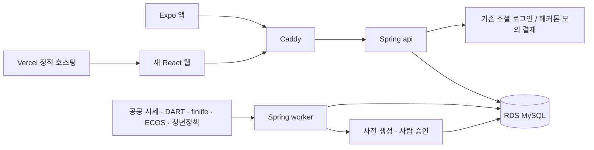

> 2026-10-20: 웹 제품 문서의 정본을 flexable-web으로 이전했다. 서버·계정·DB 경계는 [앱·웹 서비스 경계](04-service-boundaries.md)(2026-10-20 분리 결정)가 우선한다. 구현 현황은 [저장소 README](../../README.md), 아래 기획·회의 기록은 완료 보고가 아니다.

작성: 2026-10-18, 기획·디자인·개발 에이전트 3라운드 교차 리뷰 후 팀장 확정 반영

# 데스크톱 웹사이트 통합 계획서

이 문서는 새 웹의 **계획**이며 구현 완료 목록이 아니다. 근거는 [기획](01-product.md)(01), [디자인](02-design.md)(02), [아키텍처](03-architecture.md)(03), [와이어프레임](../reference/wireframes.html), [팀장 확정](decisions.md)이다. 숫자의 원 출처·가정은 해당 절에서 확인한다.

## 1. 정의·목표와 심사 포인트

**“첫 금융 선택 전에, 내가 아낀 돈으로 먼저 연습하는 입구.”** 웹이 메인(상품 이해·같은 조건 비교·그때 있었던 일 학습)이고, 앱은 매일 기록해 시드머니를 만드는 입구다(01 §0·§2-2).

- **BM:** 청년은 무료로 연습하고, 기관은 그 연습을 교육에 쓰는 값을 낸다. 웹 코스 하나, 구매자 셋. 기본 연 4,810만원은 공급가액·계약 단위 가정이다(§4).
- **시장성:** 저축·투자 청년 약 709만명, 매달 모으는 돈 약 6.7조원을 대상으로 한다. 조사 모집단·비율에 따른 계산·가정이며 우리 매출이 아니다(01 §6).
- **대중성:** 내 기록·쉬운 말·비로그인 체험·무료 근거 읽기로 시작한다. 11/2~11/4에 5초 인지율·과제 완료 n/N(first_result ÷ trial_start 세션 수, 이탈 포함 자동 집계·수기 백업)·첫 결과 시간 중앙값·3문항 전후·990원 지불 의향을 잰다(01 §8).

오프닝 30초: 0~8초 비로그인 랜딩·[3년 전] 예시 첫 결과 → 8~16초 [앱에서 내 돈 모으기]·미리 연 탭에서 점심 8,500원 입력·웹 current 감소 → 16~24초 금리 변경 카드(무슨 일·근거·고지). 비로그인 체험 탭과 로그인한 시연 계정 탭을 따로 준비한다(03 §13).

## 2. 앱 ↔ 웹 루프

| 흐름 | 사용자 행동·돌아올 이유 |
|---|---|
| 앱에서 매일 기록 → | 입력한 수입·지출·고정지출로 오늘 쓸 돈을 확인한다. |
| 시드머니 → | 끝난 월급 주기별 수입−지출을 누적하고 저축 속도를 구한다. 직접 수정도 가능하다. |
| 웹에서 실험 → | 같은 돈·같은 기간으로 주식·적금·조합을 비교하고 사건 핀의 근거를 읽는다. |
| 목표 → 앱에서 다시 기록 | 웹 목표로 더 모을 이유를 얻는다(출시 후 그림). 웹 목표 화면은 해커톤에서 빼고 발표 자료로만 보여 준다(확정 17). |

근거: 01 §3, decisions 확정 1·8. 거래 입력 직후 바뀌는 값은 확정 총액이 아니라 **이번 주기 남기는 중 `current`**다. `todaySaved`는 오늘 표시용이며 누적하지 않는다. 시연 지수는 확정 470,000원·월 속도 78,000원이다(03 §3-4·§13-1).

## 3. 기능과 해커톤 범위

| ID | 이름 | 한 줄 설명 | 해커톤 범위 | 무료/유료 |
|---|---|---|---|---|
| F0 | 공통·시드머니 | 같은 계정 로그인, 비로그인 체험, 기록 합계·직접 입력·고지 | Must | 무료 |
| F1 | 주식 타임머신 | 국내 주식·국내 상장 지수 ETF를 소수점 매수로 계산하고 사건 핀·근거 제공 | Must(시연 종목 10~15개·3년 일봉 사전 스냅숏 1회 적재·사건 카드 20건 이상) | 기본 실험·사건 전부 무료; 정밀 모드 유료·정식 제공은 이후 |
| F2-a | 적금 비교 | 현재 공시 상품은 사용자 정렬, 과거는 한국은행 평균 금리로 비교 | Must | 무료 |
| F2-b | 정책 적금 | 청년미래적금 조건 직접 입력·기여금 추정, 자격 판정·가입 연결 없음 | Must | 무료 |
| F3 | 조합·프리셋·공유 | 배분 실험·저장·비교·읽기 전용 공유, 공유 금액 기본 숨김 | 프리셋 저장·비교 Must, 공유 링크 Should | 기본 무료; 한도 확대 유료 |
| F4 | 청년 돈 소식 | 공공 원문·대상·마감·오늘 할 일·계산 연결·필터·챙기기 | Must(승인된 소식 10건) | 소식·필터·저장 전부 무료 |
| F5 | 첫 방문 안내 | 안내 모달에서 기본 실험 자동 실행, 봤음·고지 확인 저장 | Must | 무료 |
| F6 | 플러스 | 요금표·리마인더 등록 시연·모의 결제 완료/실패/해지 | 요금표·모의 결제 Must, 리마인더 등록 시연 Should | 유료 가치 시연; 실제 청구·발송 없음 |
| F7 | 웹 목표 | 목표 설정·진행 확인, 앱 홈 표시 제외 | 뺌(발표 자료로만) | 목표 1개 무료(01 §5-3) |
| F8 | 자체 사용 지표 | 체험 시작·첫 결과·핀 열기·프리셋 저장만 실측 | Should(이벤트 4종) | 공통 운영 기능 |
| [F9](01-product.md#f9-상품-카드-3장--해커톤-should확정-24) | 상품 카드 3장 | 적금·국내 주식·지수 ETF의 조건 설명과 내 돈으로 돌려 보기 | Should(확정 24, 기존 설명 패널 안) | 무료 |
| F6 확장 | 리포트·정밀 | 월간 리포트 샘플은 발표 자료로만 제공, 정밀 모드는 해커톤에서 뺌 | 뺌 | 유료 |
| 범위 밖 | 자동화·상담 등 | 우대조건 계산·계정 합치기·실제 메일·서버 개인화 고도화·실시간 AI·앱 홈 목표 | 뺌 | 해커톤에 제공하지 않음 |

근거: 01 §4·§10, 03 §12, decisions 확정 2~9·13·17. 심사에서 BM을 화면으로 보여 줘야 하므로 플러스(요금표·모의 결제)는 Must로 정했다. 웹 목표·월간 리포트 샘플·동적 공유 이미지·교실 목업 화면은 뺀다. 발표 자료로만 보여 준다. 실제 매매·계좌 연결·종목 판단·AI 종목 상담·가입 중개는 제공하지 않는다(01 §5-4·§10).

기본 실행은 **지금 저축 속도로 + 3년 전부터**다. 한 번에·매달 나눠서도 가능하다. 기간 칩은 [1년 전] [3년 전·기본] [날짜 지정], 모두 무료다. 기준일은 스냅숏 마지막 거래일이며 날짜 지정은 데이터 첫날·종목 상장일 이후부터 기준일까지다(01 §4 F1, decisions 확정 2).

## 4. BM·매출·시장

**월 990원·연 9,900원, 연 기본 선택. 웹에서만 판매한다**(01 §5-2·§5-7, decisions 확정 7). 해커톤은 모의 결제이며, 아래는 출시 후 상품 경계다.

| 무료 | 플러스 |
|---|---|
| 소식·필터·챙기기, 적금·정책 적금, 공유 | 대표 가치: 정책 마감 리마인더; 월간 내 돈 리포트(내 기록 해설만) |
| 넣는 방식 3종·기간 칩·날짜 지정·사건 설명 전부 | 정밀 모드: 배당 재투자·수수료·세금; 광고 없음 |
| 종목/상품 3개·프리셋 3개·비교 2개·웹 목표 1개 | 종목/상품 5개·프리셋 50개·비교 5개 |

한도 숫자는 서버 설정값이다(01 §5-3). 첫 결과는 잠그지 않고 한도를 누른 자리의 팝오버로 안내한다. 미구현 유료 기능을 구매 가능한 기능으로 노출하지 않는다(01 §4 F6·§10).

- **매출 본체:** 대학·청년센터 / 공공·기업 HR / 자산형성 사업 운영기관의 교육 좌석과 학습 활동 후원 캠페인. 교육은 개인 기록 없이 가상 금액·설명 과제를 사용한다. 캠페인은 서버가 확인하는 학습 활동 기준이며 편집 소식과 분리해 광고로 표시한다. 해커톤은 발표 구상만이다(01 §5-4).
- **하지 않는 것:** 가입 건별 중개 수수료, 종목 판단·전망·AI 종목 상담, 개인 데이터 판매. 앱 안에는 가격·결제 링크를 넣지 않는다(01 §5-1·§5-7).
- **발표용 BM:** 당장 실결제는 하지 않는다. 기업 교육·자산형성 사업 연계·학습 활동 후원 캠페인 등 확장 아이디어는 [bm-ideas.md](bm-ideas.md)(확정 20).
- **실결제 전제:** 상업 시세 라이선스·사업자·PG 계약·법률 검토 완료. 교육·캠페인 단가는 미확인 가정이다(01 §5-1·§5-6).

**2차 회의 합의 BM 시나리오(연간)** — 구독은 전원 연 결제·VAT 제외 공급가액(1인 연 9,000원) 기준이다.

아래 판매량·단가·매출은 모두 **가정**, VAT 제외 공급가액이며 금액은 만원 단위다. PG 수수료·교육 운영비는 비용으로 별도 반영한다.

| 매출원(구매자) | 보수 | 기본 | 낙관 | 검산 |
|---|---|---|---|---|
| 개인 플러스(청년) | 75명 × 9,000원 = 67.5만원 | 900명 × 9,000원 = 810만원 | 2,500명 × 9,000원 = 2,250만원 | 웹 MAU 5,000 / 30,000 / 50,000명 × 전환율 1.5% / 3% / 5%(낙관은 3년차) |
| 교육 좌석① 대학·청년센터 | 2건 × 50만원 = 100만원 | 10건 × 100만원 = 1,000만원 | 40건 × 150만원 = 6,000만원 | 기본 1건 100만원 = 반 50석 × 2만원. 모수·단가 미확인 |
| 교육 좌석② 공공·기업 HR | 3곳 × 50석 × 2만원 = 300만원 | 10곳 × 50석 × 2만원 = 1,000만원 | 34곳 × 50석 × 2만원 = 3,400만원 | 150석 / 500석 / 1,700석 ÷ 공공기관 신규채용 약 27,000명 = 약 0.5% / 1.8% / 6.2%(소수 첫째 자리 내림) |
| 교육 좌석③ 자산형성 사업 | 1계약 × 250석 × 1만원 = 250만원 | 2계약 × 250석 × 1만원 = 500만원 | 8계약 × 250석 × 1만원 = 2,000만원 | 250석 / 500석 / 2,000석 ÷ 청년내일저축계좌 24,145명 = 약 1.0% / 2.0% / 8.2%(소수 첫째 자리 내림) |
| 학습 활동 후원 캠페인 | 0건 = 0원 | 1건 × 1,500만원 = 1,500만원 | 4건 × 2,000만원 = 8,000만원 | 단가 미확인. 보상 재원은 매출 제외 |
| **합계** | **67.5 + 100 + 300 + 250 + 0 = 약 717.5만원** | **810 + 1,000 + 1,000 + 500 + 1,500 = 약 4,810만원** | **2,250 + 6,000 + 3,400 + 2,000 + 8,000 = 약 2억 1,650만원** | 구독 비중 = 67.5 ÷ 717.5 / 810 ÷ 4,810 / 2,250 ÷ 21,650 = 약 9.4% / 16.8% / 10.3%(소수 첫째 자리 내림) |

기관 좌석 수혜자는 개인 구독자로 다시 세지 않는다. 기관은 개인 기록을 볼 수 없고 집계만 받는다.
공식 모수는 [공공기관 신규채용 약 2.7만명](https://www.korea.kr/news/policyNewsView.do?newsId=148963765), [청년내일저축계좌 최종 선정 24,145명](https://www.korea.kr/briefing/pressReleaseView.do?newsId=156783452)이다. 사업 기준·출처는 [BM 아이디어 §자산형성 사업 확인](bm-ideas.md#자산형성-사업-확인). 전자는 청년 한정 수치가 아니다.
모수 × 도입률은 시장 민감도 참고일 뿐 매출 예측이 아니다. 위 표는 계약·좌석 수 가정으로 계산한다.

**시장 규모:** TAM 청년 967만명, SAM 저축·투자 청년 약 709만명(조사 모집단×비율 계산·가정), SOM은 3년 가입 7만명(가정). 청년 저축·투자금 월 약 6.7조원·연 약 80조원은 자금 흐름 규모다. 교육 시장 규모는 미확인이다(01 §6). 운영비 약 월 15만~21만원·손익분기 구독자 약 210~290명은 데이터 라이선스·인건비 제외 가정이다(01 §5-5).

## 5. 화면 구성과 와이어프레임

**IA:** 랜딩 → 로그인/체험 → 홈 → 굴려보기(주식 타임머신·적금 비교·섞어보기). 상단에는 청년 돈 소식·플러스·내 정보도 둔다. 플러스에서 결제 결과, 공유 링크에서 공개 결과로 연결한다(02 §3).

**공통 레이아웃:** 상단 바 64px+굴려보기 탭 48px, 시드머니 칩. 본문 최대 1280px, 실험 화면은 조건 300px / 차트 가변 / 오른쪽 레일 360px. 소식·공유는 모바일 완전 동작 우선, 시뮬레이션은 데스크톱 우선이다(02 §4, 01 §4 F0). 레일은 사건 목록·상세, 상품 상세, 프리셋 등 보조 정보로 쓰며 로딩·빈 상태·오류도 설계한다.

| 화면·경로 | 무엇을 하는가 |
|---|---|
| 랜딩 `/` | 정적 예시 차트·핵심 가치·무료 체험 진입 |
| 로그인 `/login` | 카카오·Google·이메일, 앱과 같은 문구·흐름 |
| 홈 `/home` | 확정 시드머니·current·todaySaved·직접 수정·추이 |
| 주식 `/lab/stocks` | 조건·원금/평가액/적금 비교선·사건 목록/상세 |
| 적금 `/savings` | 지금 상품 한 화면, 금융권 선택지로 정책 적금 조건 입력(2026-10-20 과거 평균 삭제) |
| 섞어보기 `/lab/mix` | 배분·비교·프리셋 저장·공유 |
| 소식 `/news`, `/news/:id` | 혜택·대상·마감·원문·계산 연결·챙기기 |
| 플러스 `/plus` | 무료/유료 가치·모의 결제(Must)·리마인더 등록 시연(Should). 월간 리포트 샘플은 발표 자료로만 |
| 내 정보 `/me` | 계정·앱 기록 상태·구독·화면 설정 |
| 목표 `/goal` | 웹 목표 설정·진행 확인 — 해커톤에서 뺌(발표 자료로만, 확정 17) |
| 공유 `/p/:id` | 기준일 고정 결과·고지·내 돈으로 체험 진입 |
| 결제 결과 `/billing/result` | 모의 완료·실패·해지 확인 |
| 약관·개인정보·지원 | `/terms`, `/privacy`, `/support`: 앱과 같은 원문·지원 |

화면 근거: 02 §3·§5. OAuth 콜백 경로는 **`/oauth/callback`**으로 정했다(앱·Expo 웹과 같은 경로, 서버 허용 목록에 새 웹 주소만 추가. 팀장 결정 14).

**와이어프레임 열기:** 브라우저로 `docs/reference/wireframes.html`을 연다. 위쪽 점선 띠에서 **화면·상태·플랜(사용자: 무료/플러스/체험)·테마**를 전환한다. 띠는 시연 조작용이며 제품 UI가 아니다. 외부 스크립트·글꼴 없이 동작하는 클릭형 설계 샘플이다(02 §12).

## 6. 아키텍처·앱 연동·데이터 권리

ADR-1은 2026-10-20 **앱·웹 서버 분리로 바뀌었다**([04](04-service-boundaries.md)가 우선). ADR-2·4·6·8은 교차 리뷰 합의다. 웹 API·worker 구현은 아직 **계획 상태**이며 나머지 미합의 ADR은 팀장 확인을 기다린다(03 §1).

| ADR | 결정 요약(03 §1) |
|---|---|
| ADR-1 | (2026-10-20 변경) 웹 전용 서버(flexable-web `backend/`)·DB·계정, 앱 정보는 [앱 연동하기]로만 받음. 같은 jar를 api·worker 프로필로 나눠 실행하는 방식은 유지 |
| ADR-2 | 별도 저장소 [`flexable-web`](https://github.com/shinds-team7/flexable-web)에 Vite+React+TypeScript SPA(10-19 `web/`에서 변경), 앱 시연은 그 저장소 `/m` |
| ADR-3 | 계산·고지·한도는 서버, TanStack Query와 공개 GET 캐시 사용 |
| ADR-4 | 타임머신 visx, 단순 차트 Recharts, 키보드 핀 탐색 제공 |
| ADR-5 | RDS MySQL 일봉 저장. 해커톤은 사전 스냅숏 1회 적재, 일별 증분 수집은 이후 |
| ADR-6 | 설명·소식은 사전 생성→사람 승인→DB 조회, 실시간 AI 없음 |
| ADR-7 | 앱과 같은 Bearer JWT, 초기 localStorage+CSP, 도메인 확보 후 쿠키 전환 별도 진행 |
| ADR-8 | 해커톤은 공공 API·스냅숏, 유료화 전 상업 시세 이용권 확보 |

구성도(03 §2):

**앱 연동:** 같은 `users/user_identities`·JWT·API를 사용한다. 기기 사이 자동 로그인 공유가 아니라 같은 계정으로 각각 로그인하는 방식이다. 기존 소셜 로그인 start→공급자 콜백→일회용 코드 exchange 흐름을 재사용한다. 웹은 앱 예산 설정을 강제하지 않고 기록이 없으면 직접 입력·체험으로 시작한다(03 §3-1~2).

시드머니는 `GET /api/v1/me/seed-money`로 주기별 합계·current·todaySaved·직접 수정 우선값을 받으며 거래 원본은 받지 않는다. 수정 API는 **`PUT·DELETE /me/seed-money/manual`**로 정했다(03 §8, 팀장 결정 15). 모든 금액은 서버가 원 단위 정수·내림으로 계산한다(01 §3-3, 03 §3-4·§6·§8).

| 데이터 | 용도·라이선스 리스크(03 §4, 01 §7) |
|---|---|
| 금융위 공공 주식·증권상품 시세 | 국내 일봉. 개발·운영 활용신청 자동승인, **공공누리 제4유형: 출처표시·상업적 이용금지·변경금지**. 비상업 해커톤은 §9 조건 3가지, 상업 이용 전 KRX 유료 구매 |
| OpenDART·공식 보도자료·자체 사건 카드 | 사건 근거·사전 설명. DART 상업 이용·재배포 조건은 서면 확인 권장. 기사는 제목·언론사·링크만, 본문 저장·LLM 입력·요약 금지 |
| finlife·한국은행 ECOS | 현재 상품 공시·과거 평균 금리. finlife는 상품별 과거 금리가 없어 매일 스냅숏 시작; ECOS 적금 항목·이용 조건 확인 필요 |
| 온통청년·공공서비스·정책브리핑 | 공공 원문 기반 소식. 운영 승인·자료별 공공누리·사진 권리 확인, 본문 이미지 사용 안 함 |

시세 근거는 [금융위 주식시세정보](https://www.data.go.kr/data/15094808/openapi.do)다(개발·운영 자동승인, 공공누리 제4유형). KIS는 제휴 조건 때문에 사용하지 않는다(03 §4-1).

## 7. 인프라·배포·폐쇄망 VM

- **AWS 제안:** EC2 t3.medium(4GB)+EBS gp3 30GB+탄력적 IP, DB는 별도 RDS MySQL. EC2 쪽 월 약 $45, RDS·Vercel Pro 포함 약 $85~110(약 12만~15만원, 환율 1,400원 가정). 리전·사용량·세금에 따라 달라지는 추정이며 라이선스·PG·LLM은 별도다(03 §9-2).
- **Vercel:** 새 웹 정적 빌드 배포, 공유 `/s/:id`는 API OG HTML을 거쳐 `/p/:id`로 연결한다. Hobby는 비상업용, 실결제 전 Pro(월 $20/좌석) 또는 정적 호스팅 이전을 검토한다(03 §1 ADR-2·§4-5).
- **DuckDNS:** 10/30(금) 도메인을 구매하고 웹 `www`·API `api`를 연결한다(확정 18).
  이미 설치된 앱 1.1.0이 `flex-able-sh.duckdns.org`를 부르므로 DuckDNS도 그대로 함께 서비스한다.
  앱 API 주소는 EAS 환경 변수 변경 후 원격 업데이트로 바꾼다.
  카카오·Google 콘솔에 새 콜백 주소를 추가하고, `OAUTH_ALLOWED_REDIRECT_URIS`·CORS·Caddy 사이트를 추가한다.
- **CI:** 웹 타입 검사·빌드·기본 실행→핀→공유 E2E, 서버 계산·계약·권한·무료 한도·운영 demo-login 차단, 수집 중복·부분 실패·누락일 검증. 비밀값은 api/worker 환경으로 분리하고 웹에는 공개 API 주소만 넣는다(03 §9-3).
- **배포 계획:** DB 백업→Flyway→API 헬스 확인→웹 반영. 이전 이미지 복구·마지막 성공 스냅숏·기준일 표시를 준비한다(03 §9-1·§9-5).

반입 작업 여부는 확정 19를 따른다. 10/19 조건 확인 뒤 AWS 운영본 시연이 가능하면 반입 묶음은 만들지 않는다.

| 폐쇄망에서 안 되는 것 | 대체 경로(03 §9-7~8·§13) |
|---|---|
| Vercel·AWS·외부 API 접근 | Caddy가 정적 웹과 /api를 같은 VM 주소로 제공, 로컬 MySQL에 시세·금리·승인 설명·소식 복원, worker·외부 호출 끔 |
| 카카오·Google 인증 | 공급자 목록을 비우고 이메일 시연 계정·오프라인 전용 진입 사용 |
| 앱 운영 거래의 실시간 반영 | 앱 장면은 녹화, 로컬 입력 전/후 상태로 current 변화. 라이브 연동처럼 설명하지 않음 |
| 외부 근거 링크·카톡 OG·실제 PG·폰 접속 보장 | 캡처·영상, 로컬 공유 새 탭, 모의 결제. 휴대폰 접근 허용 여부는 주최 측 확인 |
| 외부 CDN·글꼴·인증서 발급 | 자원을 번들에 포함. 내부 HTTP가 기본; HTTPS 필수면 주최 루트 인증서 사전 설치 조건으로 tls internal |

VM 반입이 필수면 W2 후반 첫 복원 리허설, W3 초 최종 반입을 진행한다. 반입물은 웹 빌드·컨테이너 이미지 tar·MySQL/시연 SQL·Compose/Caddy·스냅숏·초기화 설명서·앱 영상·체크섬/버전/기준일 목록이다. 외부망을 끈 깨끗한 VM에서 복원·초기화·전체 흐름을 검증한다(03 §9-7·§12-2).

## 8. 작업 분담·일정·첫 주 체크리스트

일정: 3주(10/19~11/7), 인원 FE·BE·DATA·콘텐츠 각 1명 가정(확정 17)

| 담당 | 산출물·완료 기준 |
|---|---|
| FE·디자인 | 웹 골격·로그인·차트/핀·첫 방문 안내·적금 비교·조합/프리셋·소식·플러스 모의 결제 |
| BE | 시드머니·타임머신·적금 계산 API·권한/한도·프리셋·온보딩·모의 결제. VM 필수 시 오프라인 프로필 |
| DATA | 시연 종목 10~15개·3년 일봉 사전 스냅숏 1회 적재·finlife·ECOS 금리 스냅숏·기준일 고정 |
| 콘텐츠·기획 | 사건 카드 20건 이상 승인·소식 10건·정책 적금 출처/가정·고지·대본 검수 |
| 대표·운영 | 10/19 VM 조건 확인·정책 적금 담당 배정, 권리/예산·개인정보 결정, 10/30 도메인 구매 |

| 주차 | 통합 목표 | 완료 기준 |
|---|---|---|
| W1 10/19~10/25 뼈대·데이터 | 10/19 VM 조건 확인·정책 적금 담당 배정·API 계약 하루 안에 고정. FE web 골격·로그인·타임머신 차트·핀 툴팁·첫 방문 안내. BE 시드머니·타임머신 계산·적금 비교 API. DATA 시연 종목 스냅숏·finlife·ECOS 금리 스냅숏. 콘텐츠 사건 카드 20건 초안 | 운영(Vercel+EC2)에서 로그인→시드머니→타임머신 기본 실행→핀 상세 한 흐름 |
| W2 10/26~11/1 기능 완성 | 적금 비교·정책 적금 가정 계산기, 조합·프리셋 저장·비교, 승인된 소식 10건, 플러스 요금표·모의 결제. 10/30 도메인 구매·연결. VM 필수 시 W2 후반 첫 복원 리허설 | 11/1(일) 기능 동결, Must 전부 운영에서 동작 |
| W3 11/2~11/7 발표 준비·최종 피드백 | 신규 기능 없음·버그만 수정. 11/2~11/4 청년 5~10명(Play 비공개 테스터 포함) 과제형 사용 테스트(자동 집계·수기 백업)→11/5까지 반영. 시연 데이터 고정·대본·영상. VM 필수 시 W3 초 최종 반입 | 11/5까지 피드백 반영, 11/6 최종 리허설, 11/7 완료 |

**첫 주에 할 일**:

- [ ] 10/19 대표: 회사에서 VM 조건 확인·반입 여부 결정, 정책 적금 공식 근거를 확인할 팀원 배정.
- [ ] 10/19 BE·FE: 시드머니·타임머신·적금 비교 API 계약을 하루 안에 고정.
- [ ] 10/19~10/25 DATA: API 키·운영 승인 신청, 시연 종목 10~15개·3년 일봉과 finlife·ECOS 금리 스냅숏 확보·적재.
- [ ] 10/19~10/25 콘텐츠·DATA: 사건 카드 20건 초안·근거, 정책 적금 공식 출처 확보. 시연 지수 470,000원/월 78,000원 고정.
- [ ] 10/19~10/25 FE·BE: web 골격·로그인·시드머니·타임머신 계산·차트·핀 툴팁/상세·첫 방문 안내 연결.
- [ ] 10/25 FE·BE·DATA·콘텐츠: 운영(Vercel+EC2)에서 로그인→시드머니→타임머신 기본 실행→핀 상세 확인.

밀리면 공유 링크→리마인더 시연→사용 지표 순으로 줄인다. 타임머신·사건 설명·적금 비교·프리셋·플러스 모의 결제·승인 소식 10건을 유지하며 정책 적금 약 17만원 계산 차이 해소는 Must다(01 §10, 확정 17).

## 9. 상위 리스크와 대응

| 우선 | 리스크 | 대응·담당 |
|---|---|---|
| 1 | 시세 이용 조건·상업 전환 | 공공데이터포털 활용신청 범위에서 실제 시세를 쓴다. 금융위 별도 허락은 필수가 아니다. 시연 조건 3가지를 지킨다: ① 출처 표시("금융위원회 주식시세정보, 공공데이터포털, 공공누리 제4유형") ② 원본 시세를 다운로드·API로 다시 제공하지 않고 화면 그래프·계산 결과만 표시 ③ 비상업 해커톤 시연임을 고지. 유료 구독 등 상업적 이용 전에는 KRX Data Marketplace 유료 데이터 구매가 필요하다(확정 20: 상업 시세 계약은 안정화 뒤). 금융위·KRX 서면 문의는 선택(필요할 때만)이다. / 대표·DATA(01 §7, 03 §13) |
| 2 | 투자 조언·상품 추천/중개로 오인 | 과거 사실·고지·전부 무료 사건 설명, 사용자 정렬만·가입 버튼/건별 대가 없음 / 기획·BE·FE |
| 3 | 근거 없는 인과 설명·기사 권리 침해 | 공식 근거·자체 카드·사람 승인만 공개, 기사 본문 미사용 / 콘텐츠·DATA |
| 4 | 계산 규칙·시세 기간/수정계수 불확실 | 정책 추정·가정/출처/버전 표시, 실제 호출·손계산 검증, 보정 불가면 계산 불가와 사유 / 기획·DATA·BE |
| 5 | 인증·외부망 장애·반입 실패 | 이메일 시연 계정·로컬 스냅숏·영상·모의 결제, 깨끗한 VM 리허설 / BE·FE·운영 |

예시 데이터 대본은 시세 API 장애·데이터 문제 때의 백업으로만 준비한다.

근거: 01 §7, 03 §11-4·§13. 개인정보는 합계만 전달·공유 금액 기본 숨김·지표 개인 정보 제외로 제한한다. F8은 `trial_start` · `first_result` · `pin_open` · `preset_save`만 수집한다. 완료율은 first_result 세션 수 ÷ trial_start 세션 수(이탈 포함)다. 익명 세션 ID·시각·허용 속성만 받고 금액·사용자 ID는 받지 않는다. 원시 지표는 **30일 보존 후 삭제, 집계만 유지**로 정했다(03 §11-2, 팀장 결정 16). 수집을 시작하기 전에 개인정보처리방침에 반영해야 한다.

## 10. 대표에게 물어볼 질문

2차 회의 T1~T5와 차별점은 [팀장 결정 결과 §7](meeting-2026-10-18.md#7-팀장-결정-결과2026-10-18)에 반영했다(decisions 확정 2·17 변경, 21~24 추가).

01 §12, 02 말미 질문, 03 §15를 중복 제거했다. 가격·매수 단위·무료 설명·지표 보존(30일) 등 확정 사항은 다시 묻지 않는다. 모바일 소식·공유 우선은 화면 인수 기준에 반영했다(01 §4 F0, 02 말미 질문).

10/18 답변 반영. 확정된 일정·도메인·BM 용도와 10/19 확인·배정 계획을 기록했다.

| 우선·질문 제목 | 선택지 | 팀 추천·결정 시점 |
|---|---|---|
| Q1. 해커톤 뒤 실제 결제(990원) 여부 | 실제 결제 추진 / 보류 | **답변:** 당장 실결제 계획 없음. BM은 발표에서 수익성·시장성을 보여 주는 용도(심사 배점 큼). 해커톤은 모의 결제, 상업 데이터·PG는 서비스 안정화 뒤 검토. 추가 BM은 [bm-ideas.md](bm-ideas.md)(확정 20) |
| Q2. 발표 일정·담당 인원·편집 책임 | 3주 일정·범위 축소 | **답변:** 3주, 11/7(토)까지 완료. 마지막 주는 발표 준비·최종 사용자 피드백. FE·BE·DATA·콘텐츠 각 1명 가정 유지(확정 17) |
| Q3. 주최 폐쇄망·VM·반입 조건 | VM 필수 여부부터 확인 | **답변:** 10/19 회사 확인 예정. [아래 체크리스트](#폐쇄망-vm-확인-체크리스트1019)로 확인한 뒤 반입 여부 결정(확정 19) |
| Q4. 정책 적금 공식 계산 규칙 | 담당 지정·공식 설명서 확보, 확인 전 가정 계산기 시연 | **답변:** 10/19 팀원 배정 예정. W1 안에 기여금 시점·이자·금리 구조·중도해지 공식 출처 확보 목표. 미확인 조건은 가정 표시 |
| Q5. 도메인·인프라 예산 | 웹 `www`·API `api`, DuckDNS 함께 서비스 | **답변:** 10/30(금) 구매. DNS·Caddy·CORS·OAuth 콜백 추가, 앱 API 주소는 EAS 환경 변수 변경 후 원격 업데이트(확정 18) |
| Q6. 베타 실측·출시 승인 담당 | 11/2~11/4 청년 5~10명 과제형 사용 테스트(Play 비공개 테스터 포함) | 11/5까지 반영. 예상치를 실적으로 발표하지 않고 유료화 검토·승인 담당 지정(확정 17, §8) |
| Q7. 교육 고객 관심 확인 | A 대표가 기관 연결 / B 공개 모집·인터뷰 / C 발표 후 검증 | A, 없으면 B. 교실 목업·가격 가정으로 관심과 계약 구분; 연락은 대표 수행(01 Q6) |
| Q8. 신한 API·데이터·브랜드·제휴 배지 허락 | A 서면 허락/계약 있음 / B 문의 창구 있음 / C 없음·배지 미도입 | B로 확인, 허락 전 화면 명칭·로고·배지 미사용. 계약 후 정렬 유지·배지만 검토(01 Q7, 02 Q7) |
| Q9. 기본 프리셋 제공 방식 | A 구성 요약 2~3개 / B 제공하지 않음 | A 추천. 성향·추천 이름 없이 예시 조합으로 표시(02 Q5, 01 §4 F3) |

Q 표는 10/18 답변을 우선한다. 남은 담당자·권리·예산은 확인 후 채운다.

### 폐쇄망 VM 확인 체크리스트(10/19)

1. VM 시연이 필수인가. 인터넷 되는 노트북으로 AWS 운영본을 시연해도 되는가. 가장 먼저 확인한다.
2. VM에서 외부 인터넷 접속이 가능한가. 전면 차단·허용 도메인 목록·프록시 중 어떤 조건인가.
3. 심사위원은 어떻게 접속하는가(VM 안 브라우저·내부망 PC·휴대폰 와이파이). 접속 주소와 열 수 있는 포트(80/443)는 무엇인가.
4. HTTPS가 필수인가. 사내 인증서를 제공하는가.
5. VM 사양(OS·CPU·RAM·디스크)은 무엇인가. 관리자 권한과 Docker 설치가 가능한가.
6. 파일 반입 방법(망연계·USB·보안 검사)과 용량 한도는 무엇인가(예상 1~2GB). 검사 소요 일수와 반입 마감일은 언제인가.
7. 사전 설치·리허설 가능한 날과 당일 준비 시간은 언제인가.
8. 휴대폰(앱 시연) 반입·화면 미러링이 가능한가. 불가하면 앱은 영상으로 보여 준다.
9. 카카오·Google 로그인이 불가하면 이메일 시연 계정으로 대체해도 되는가.
10. GitHub·Vercel 등 외부 서비스 사용이 평가에 문제가 되는가.

## 11. 문서 지도

| 알고 싶은 것 | 파일·절 |
|---|---|
| 문제·타깃·경쟁·앱↔웹 루프 | [01-product.md](01-product.md) §1~3 |
| 기능 ID·무료/유료·BM·매출·시장·KPI·피칭 | [01-product.md](01-product.md) §4~10 |
| 사이트맵·화면·레이아웃·차트·토큰·컴포넌트·문구 | [02-design.md](02-design.md) §3~11 |
| 클릭형 화면·상태·플랜·테마 | [wireframes.html](../reference/wireframes.html), [02-design.md](02-design.md) §12 |
| ADR·구성·인증·시드머니·데이터/권리·계산·DB·API | [03-architecture.md](03-architecture.md) §1~8 |
| 인프라·폐쇄망·결제·보안·WBS·주별 일정·시연 | [03-architecture.md](03-architecture.md) §9~13 |
| 팀장 최종 확정 기준 | [decisions.md](decisions.md) 「확정 사항」 |
| 발표용 BM 확장 아이디어·기획 담당 할 일 | [bm-ideas.md](bm-ideas.md) |
| 2차 회의 기록·팀장 결정 결과(§7)·선택 문의/설문 초안 | [meeting-2026-10-18.md](meeting-2026-10-18.md) |
| 남은 이견·대표 질문 원문 | 01 §11~12, 02 말미, 03 §14~15 |
